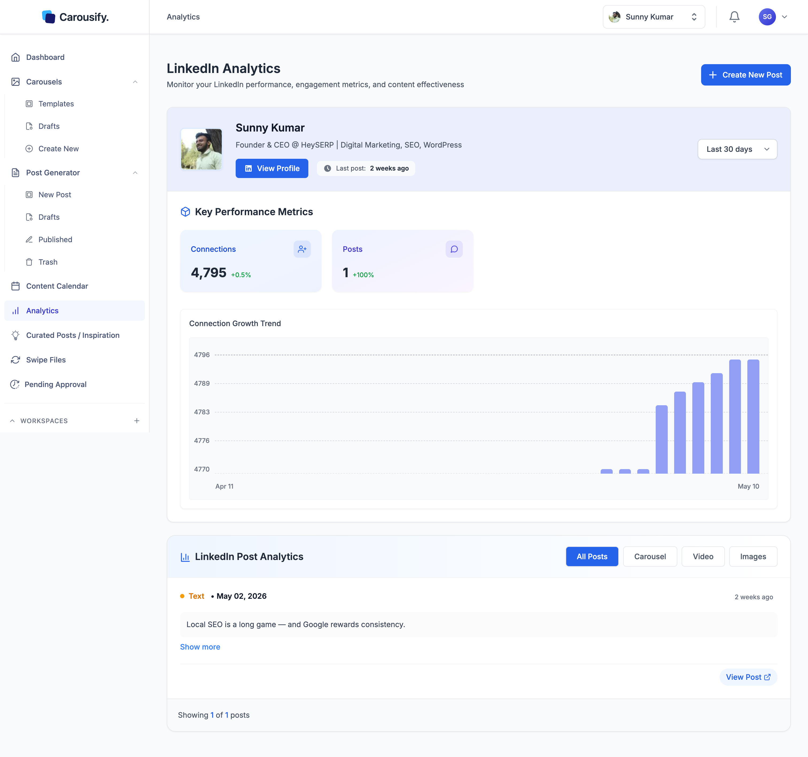

The **Analytics** page is where you check how an account is actually doing — connection or follower growth, posts shipped in the period, and a per-post breakdown for whichever account you pick. Carousify pulls data through LinkedIn's and Instagram's official APIs for every account connected to the workspace, and refreshes it **once a day**.

## Open Analytics

In the left sidebar, click **Analytics**.

The page loads numbers for whichever account is selected in the **account picker** in the top bar — a LinkedIn profile, a LinkedIn page, or an Instagram account. The page title follows the platform: **LinkedIn Analytics** or **Instagram Analytics**.

Switch accounts from that picker any time. Analytics re-fetches everything against the newly selected one.

<Note>
  Analytics is scoped to the **active workspace and the selected account**. Numbers don't pool across accounts or workspaces — switch the account picker or the workspace to see another set.
</Note>

The top card carries the account you're looking at — avatar, name, headline or bio, a **View Profile** link to the live LinkedIn or Instagram profile, and a **Last post: X ago** timestamp so you can tell at a glance how stale the queue is. **Create New Post** at the top right opens the post writer.

## Date range

On the right of the top card, the **date range** dropdown sets the window every number on the page is calculated against:

- **Last 15 days**
- **Last 30 days** (default)
- **Last 90 days**
- **Last 180 days**

Change the range and the KPI cards, the growth chart, and the post list all recompute against the new window.

## Key Performance Metrics

The cards under **Key Performance Metrics** are calculated against the date range you picked.

| Metric | What it shows |
| --- | --- |
| **Connections** (LinkedIn) or **Followers** (Instagram) | The account's total right now, with the percentage change over the selected period. |
| **Posts** | Number of posts published in the selected period, with the period-over-period change. |

Below the cards, the **Connection Growth Trend** (LinkedIn) or **Follower Growth Trend** (Instagram) chart shows one bar per daily snapshot across the range.

{/* SCREENSHOT NEEDED: images/analytics/instagram-analytics.png — Analytics page with an Instagram account selected in the top-bar account picker: title "Instagram Analytics", top card with avatar, name, bio, View Profile and Last post, Last 30 days range, Followers and Posts cards, Follower Growth Trend chart, and the Instagram Post Analytics list with at least one post showing likes and comments */}

## Post analytics

The lower section — **LinkedIn Post Analytics** or **Instagram Post Analytics** — lists every post the account published in the date range, newest first.

Each card shows:

- **Post type** — `Text`, `Carousel`, `Video`, or `Images`
- **Publish date** plus a relative timestamp (e.g. *2 weeks ago*)
- **Post body** — collapsed by default; click **Show more** to expand
- **Media** — the images, video, or PDF attached to the post
- **Likes and Comments** — for **Instagram accounts** and **LinkedIn pages**. LinkedIn's API doesn't provide engagement for personal profiles, so these aren't shown for them.
- **View Post** — opens the post on LinkedIn or Instagram in a new tab

Posts that were deleted on the platform after publishing are marked **Deleted**.

The four buttons on the right of the section header — **All Posts**, **Carousel**, **Video**, **Images** — filter the list down to one format at a time. Useful for answering "did my carousels outperform single-image posts this quarter?" without scrolling through the full feed.

## How data refreshes

Carousify syncs with LinkedIn and Instagram **once a day**, shortly after midnight in the [workspace timezone](/quickstart#step-2-%E2%80%94-set-up-your-workspace). Each sync stores a snapshot of the day's connections or followers and updates your posts and their likes and comments. Numbers on Analytics are from the most recent sync, not real time, and there's no manual refresh button.

Carousify also syncs an account straight away when you connect or reconnect it, so you don't have to wait until the next day for a first set of numbers. The **Last synced** time on each account's card in **Manage Workspace › Social Integrations** shows when its data was last pulled.

If a connected account stops syncing (for example, the platform rejected the connection), the page keeps showing the last known values, the account shows **Inactive** in Social Integrations, and a banner asks you to reconnect. See [Reconnect an account](/getting-started/connect-linkedin#reconnect-an-account).

<Tip>
  An AI assistant connected through the [Carousify MCP server](/mcp/overview) can read the same stored analytics — useful for asking "how did my last ten posts do?" in plain language.
</Tip>

## What's next

<Columns cols={2}>
  <Card title="Link tracking" icon="link" href="/analytics/link-tracking">
    Shorten outbound links and measure clicks back to your posts.
  </Card>
  <Card title="Schedule a post" icon="calendar" href="/scheduling/schedule-post">
    Queue more posts at peak times for your timezone.
  </Card>
  <Card title="Content Calendar" icon="calendar-days" href="/scheduling/calendar">
    See published and scheduled posts side by side.
  </Card>
  <Card title="Curated Posts" icon="sparkles" href="/post-generator/curated-posts">
    Auto-generated post ideas based on the account's niche.
  </Card>
</Columns>
