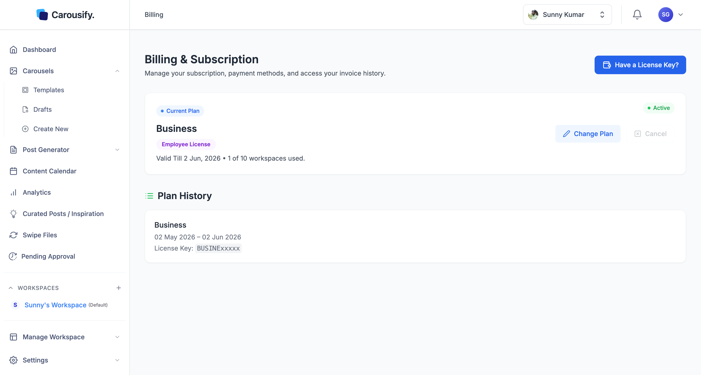

Carousify offers four paid plans — **Hobby**, **Startup**, **Business**, and **Enterprise** — each available on **Monthly** or **Yearly** billing. This page covers what's in each plan and what you can do from the **Billing & Subscription** page.

<Note>
  Live pricing always lives at [carousify.com/pricing](https://carousify.com/pricing/). The numbers below reflect public US-dollar pricing at the time of writing. In many countries Carousify applies a purchasing power parity discount automatically — you'll see a **Purchasing Power Parity** banner above the plans.
</Note>

## Where to find your plan

Open **Settings › Billing & Payments** in the left sidebar to see your current plan, renewal date, payment method, and plan history.

From this page you can:

- See your **current plan**, its status (**Active**, **Pending Cancellation**, **Cancelled**, ...), its price, the date it renews or expires, and how many of your plan's workspaces you're using
- Use **Change Plan** to switch tiers or billing cycle — see [Upgrade or downgrade](/billing/upgrade)
- Use **Cancel** to stop auto-renewal, or **Reactivate** to undo a pending cancellation — see [Cancel your subscription](/billing/cancel)
- Under **Payment Methods**, see the card on file and your last payment date, click **Download Invoice** for your latest invoice, or click **Manage Payments** to update your payment method and see past invoices in the Dodo Payments customer portal
- Browse **Plan History** for every plan you've held, with start and end dates and the subscription ID or license key it was activated with
- Click **Have a License Key?** to redeem a partner or deal code

{/* SCREENSHOT NEEDED: images/billing/payment-methods.png — Billing & Subscription page for a monthly or yearly subscriber: the current plan card with price, "Renews on …" line, Change Plan and Cancel buttons, and below it the Payment Methods card (card brand and last four digits, Last Payment date, Download Invoice, Manage Payments). Blur personal details. New image; the existing billing-overview.png shows a license-key plan without Payment Methods. */}

Payments are processed by [Dodo Payments](https://dodopayments.com/). Checkout opens on Dodo's secure page, where you can pay by card and, depending on your country, other local methods.

## Plans at a glance

<Columns cols={2}>
  <Card title="Hobby" icon="user">
    \$14.99/mo or \$149/yr. Solo creators getting started.
  </Card>
  <Card title="Startup" icon="rocket">
    \$24.99/mo or \$249/yr. Small teams managing a few brands.
  </Card>
  <Card title="Business" icon="building">
    \$49.99/mo or \$499/yr. Agencies and growing teams with approval workflows.
  </Card>
  <Card title="Enterprise" icon="briefcase">
    From \$299/mo. Whitelabel, webhooks, advanced analytics, custom limits. Contact sales.
  </Card>
</Columns>

## Compare plans

| | Hobby | Startup | Business | Enterprise |
| --- | --- | --- | --- | --- |
| AI words per month | 25K | 50K | 100K | Up to 1M |
| Workspaces | 1 | 3 | 10 | Up to 500 |
| Members per workspace | 3 | 5 | 10 | Up to 500 |
| LinkedIn / Instagram accounts | 3 | 10 | 25 | Custom |
| Community templates | — | ✓ | ✓ | ✓ |
| Archived and Trash posts | — | ✓ | ✓ | ✓ |
| Link shortening and tracking | — | — | ✓ | ✓ |
| Custom roles and [approval workflow](/workspaces/approval) | — | — | ✓ | ✓ |
| [Whitelabel](/whitelabel/overview) | — | — | — | ✓ |
| [Webhooks](/webhooks/overview) | — | — | — | ✓ |
| Advanced analytics | — | — | — | ✓ |

With [Bring Your Own Key](/workspaces/ai-assistant#bring-your-own-ai-key-byok), AI usage isn't limited by your plan's word allowance.

<Tip>
  New accounts start on the **Free** plan, which lets you explore the app but not publish. Pick a paid plan from the same page to start posting.
</Tip>

There's no free trial, but every plan comes with a 7-day money-back guarantee on your first payment. See [carousify.com/pricing](https://carousify.com/pricing/) for current offers.

## What's next

<Columns cols={2}>
  <Card title="Upgrade or downgrade" icon="arrows-up-down" href="/billing/upgrade">
    Step-by-step instructions for switching plans or billing cycles.
  </Card>
  <Card title="Cancel your subscription" icon="circle-xmark" href="/billing/cancel">
    How cancellation works, when access ends, and how to reactivate.
  </Card>
</Columns>
