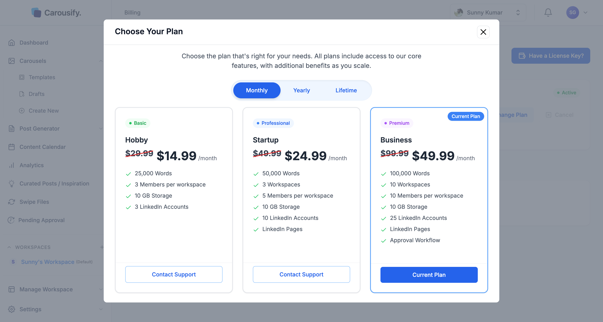

You can upgrade your plan or move from monthly to yearly billing yourself from the **Billing & Subscription** page. Downgrades — including yearly to monthly — go through support so the team can move your data and limits cleanly.

## Upgrade your plan

<Steps>
  <Step title="Open Billing & Subscription">
    Go to **Settings › Billing & Payments** in the left sidebar.
  </Step>
  <Step title="Click Change Plan">
    The **Choose Your Plan** dialog opens. If you're on the Free plan, the plans are shown directly on the page.
  </Step>
  <Step title="Pick a billing cycle">
    Toggle **Monthly** or **Yearly** at the top. (**Lifetime** only appears if you bought a lifetime plan.)

    
  </Step>
  <Step title="Select the new tier">
    Click **Select Plan** on the tier you want. Your current plan is marked **Current Plan**. Lower tiers show **Contact Support** instead. For Enterprise, click **Contact Sales**.
  </Step>
  <Step title="Pay at checkout">
    Carousify opens a Dodo Payments checkout in a new tab. Once the payment goes through, you're returned to **Billing & Subscription** and the new plan and its limits apply right away.
  </Step>
</Steps>

<Note>
  If you have a coupon code, you can enter it on the Dodo Payments checkout page.
</Note>

## Switch billing cycle

To move from monthly to yearly, follow the same steps and pick **Yearly** before you select your tier. Moving from yearly to monthly counts as a downgrade — [contact support](https://carousify.com/contact-us/).

## Downgrade your plan

To move to a lower tier, click **Contact Support** on that tier or [contact support](https://carousify.com/contact-us/) directly and tell us which plan you want. We'll handle the switch.

## What happens to your data

When you upgrade, everything stays — your new limits just kick in. Downgrades are where you need to be careful, since the lower tier has lower limits and fewer features:

- **Workspaces, accounts, and members** above the new plan's limits — agree with support what to keep before the switch.
- **Business-only features** such as custom roles, approval, and link tracking stop being available.
- **Whitelabel** (Enterprise) stops as soon as your plan no longer includes it: your branded site goes back to Carousify's branding right away, and your custom domain is released 7 days later. Your brand settings are kept. See [Whitelabel overview](/whitelabel/overview#if-your-plan-changes).
- **AI word allowance** follows the new plan from your next reset.

<Tip>
  Before requesting a downgrade, delete or archive the workspaces, accounts, and members you don't need, and export anything you want to keep.
</Tip>

## What's next

<Columns cols={2}>
  <Card title="Plans and pricing" icon="tags" href="/billing/plans">
    Compare what each plan includes.
  </Card>
  <Card title="Cancel your subscription" icon="circle-xmark" href="/billing/cancel">
    Stop auto-renewal and what happens next.
  </Card>
</Columns>
