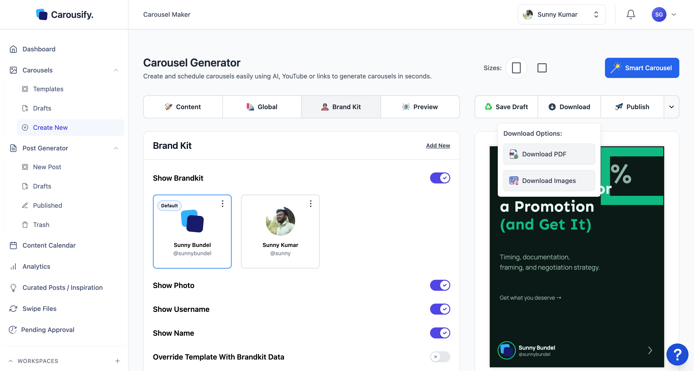
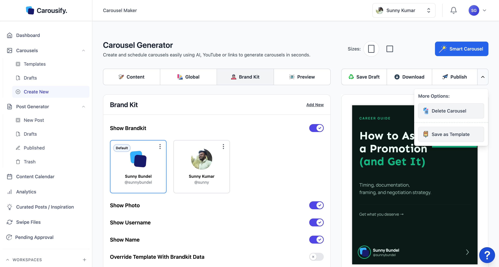

When the deck is ready, the top-right of the editor has everything you need to ship it. There are four paths out of the editor — pick the one that matches where the carousel is going.

## Which option to use

| You want to… | Use |
| --- | --- |
| Post the carousel on LinkedIn or Instagram now, or schedule it | **Publish** |
| Upload to LinkedIn yourself, or save the file for later | **Download › Download PDF** |
| Post somewhere that takes individual images — X, a newsletter, a blog | **Download › Download Images** |
| Re-use this deck as a starting point next time | **⋯ menu › Save as Template** |

## The Preview dialog

**Publish**, **Download PDF**, and **Download Images** all open the same **Preview** dialog first. It shows every slide in order and has three buttons: **Download Images**, **Download PDF**, and **Continue** (post the carousel).

At the top, fill in **Carousel Name**. LinkedIn shows this name as the title of the PDF document on your post, so write something a reader would want to open. You need a name to post the carousel.

## Download PDF

A single PDF with every slide in order — this is the format LinkedIn uses for native carousel posts. Click **Download PDF** and the file drops into your browser's downloads folder.

<Tip>
  Posting on LinkedIn yourself? Start a new post, click the **Document** icon, and pick the PDF. LinkedIn renders it as a swipeable carousel automatically.
</Tip>

## Download Images

A zip with one image per slide. Use this for any platform that takes individual images instead of a PDF — X threads, newsletters, blog embeds, or Instagram if you post from the app yourself. Slide order is preserved in the filenames.

## Post a carousel

Click **Publish**, add a **Carousel Name**, and click **Continue**. Carousify saves the deck as a draft, renders the slides, and opens the post composer with the carousel attached:

| Platform | What gets posted |
| --- | --- |
| **LinkedIn** | One PDF document with every slide — LinkedIn shows it as a swipeable carousel. |
| **Instagram** | One image per slide, posted as an Instagram carousel. Carousify adds the images automatically when an Instagram account is connected to the workspace. |

In the composer, write the caption, check the accounts under **Publish to**, and either post now or schedule for later. If you post to both platforms, you can review and adjust each account's caption and media before publishing.

<Note>
  Instagram carousels take at most **10** images, so a deck you post to Instagram can have up to 10 slides. LinkedIn takes the whole deck as one PDF.
</Note>

<Card title="Schedule a post" icon="calendar" href="/scheduling/schedule-post">
  Walk through the post composer — accounts, caption, and scheduling.
</Card>

You can also attach an existing carousel from the post composer: click **Add Carousel** in the writer toolbar and pick one from **Carousel Templates** or **Carousel Drafts**, or upload a PDF, PowerPoint, or Word document.

## Save as Template

If this deck is one you'll want to start from again, open the **⋯** menu next to **Publish** and pick **Save as Template**.

Pick how to save it:

- **Save As Private** — the template lands at the top of **Carousels › Templates**, above the Carousify-designed library, for your workspace only.
- **Save As Public** — the template is sent for review. Once approved, it appears in **Community Templates** for every Carousify user.

Open it like any other template and you're back in the editor.

<Note>
  Templates and drafts are workspace-scoped. Saving a template in one workspace doesn't make it available in another — save it again in each workspace where you'd use it.
</Note>

## Delete a carousel

Pick **Delete Carousel** from the same **⋯** menu. The draft moves to **Carousels › Templates › Trash**, where you can restore it or delete it permanently.

## What's next

<Columns cols={2}>
  <Card title="Schedule a post" icon="calendar" href="/scheduling/schedule-post">
    Pick the accounts and time when the deck should go live.
  </Card>
  <Card title="Approval workflow" icon="circle-check" href="/workspaces/approval">
    Route the post through manager review before it publishes.
  </Card>
  <Card title="Templates" icon="grid" href="/carousel-maker/templates">
    Re-use the deck (or your saved templates) for the next post.
  </Card>
  <Card title="Analytics" icon="chart-line" href="/analytics/linkedin-analytics">
    Track how the published carousel performs once it's live.
  </Card>
</Columns>
