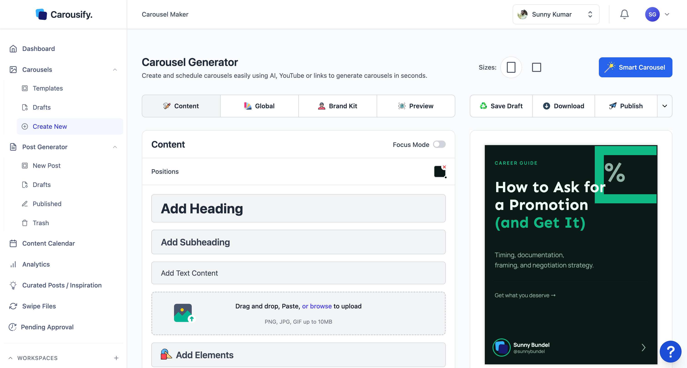

The Carousel Maker is Carousify's visual editor for LinkedIn and Instagram carousel posts. You can start from a blank canvas, drop in one of the pre-built templates, have the **AI Generator** design a deck from a prompt, or let **Smart Carousel** rewrite a design's copy from a topic, link, or YouTube video. Whatever path you start on, you end up in the same editor — slides on the left, live preview on the right, brand kit one click away.

## Where to find it

In the left sidebar, open **Carousels › Create New** to start fresh, **Carousels › AI Generator** to generate a design from a prompt, or **Carousels › Templates** to browse the gallery first. Existing work-in-progress lives under **Carousels › Drafts**.

## Four ways to start

<Columns cols={2}>
  <Card title="From scratch" icon="pen-ruler" href="/carousel-maker/create">
    Open a blank deck and add headings, text, images, and shapes slide by slide.
  </Card>
  <Card title="From a template" icon="grid" href="/carousel-maker/templates">
    Pick a pre-designed deck and swap in your own copy and colors.
  </Card>
  <Card title="With Smart Carousel" icon="sparkles" href="/carousel-maker/create#generate-with-smart-carousel">
    Rewrite the copy on an existing design from a topic, link, YouTube video, or PDF.
  </Card>
  <Card title="With the AI Generator" icon="wand-magic-sparkles" href="/carousel-maker/ai-generator">
    Describe the carousel in a prompt and get a complete design, then refine it by chat.
  </Card>
</Columns>

## What the editor gives you

- **Sizes** — four canvas presets: **Standard** (56:71), **Portrait** (4:5), **Feed** (3:4), and **Square** (1:1). Switch at any time and the whole deck reflows. See the [full size table](/carousel-maker/create#sizes).
- **Slide tools** — drag-and-drop to reorder, **Reset Slide** to revert one back to its starting state, and slide-by-slide navigation at the bottom.
- **Elements** — headings, subheadings, body text, images (PNG/JPG/GIF up to 10MB), plus shapes, icons, and decorative elements via **Add Elements**.
- **Tabs** — the editor groups its panels into:
  - **Content** — type and design the current slide.
  - **Global** — settings that apply across every slide (background, default fonts, footer).
  - **Brand Kit** — colors, fonts, and logos saved at the workspace level.
  - **Preview** — see every slide in order before exporting or posting.
- **Focus Mode** — strips the chrome away when you want to design without distractions.
- **Save Draft / Download / Publish** — top-right at all times. **Save Draft** keeps your work, **Download** exports a PDF or a zip of images, and **Publish** turns the deck into a LinkedIn PDF and Instagram images and opens the post composer.

## Brand Kit

Every workspace has a Brand Kit — saved colors, fonts, and logos that apply across every carousel you build. Pick the **Brand Kit** tab in the editor to switch between kits or pull the current one's palette into the slide you're working on.

<Card title="Configure your Brand Kit" icon="palette" href="/carousel-maker/brand-kit">
  Save the colors, fonts, and logos that should match every deck you build.
</Card>

## Keyboard shortcuts

The editor is built around shortcuts — press **?** anywhere in the canvas to open the cheat sheet. The ones you'll use most:

| Action | Shortcut |
| --- | --- |
| Save draft | `⌘ S` |
| Undo / Redo | `⌘ Z` / `⌘ Shift Z` |
| Copy / Paste an element | `⌘ C` / `⌘ V` |
| Group / Ungroup | `⌘ G` / `⌘ Shift G` |
| Lock / Unlock | `⌘ L` |
| Zoom in / out | `⌘ +` / `⌘ -` |
| Fit to viewport | `⌘ 0` |
| Select multiple | `Shift` + click |

## What's next

<Columns cols={2}>
  <Card title="Create a carousel" icon="pen-ruler" href="/carousel-maker/create">
    Walk through a full build — blank canvas, Smart Carousel, and editing each slide.
  </Card>
  <Card title="Templates" icon="grid" href="/carousel-maker/templates">
    Browse the gallery and customize a template in minutes.
  </Card>
  <Card title="Brand Kit" icon="palette" href="/carousel-maker/brand-kit">
    Save reusable colors, fonts, and logos.
  </Card>
  <Card title="Export and download" icon="download" href="/carousel-maker/export">
    Get PDFs, image sets, and LinkedIn or Instagram posts out of the editor.
  </Card>
</Columns>
