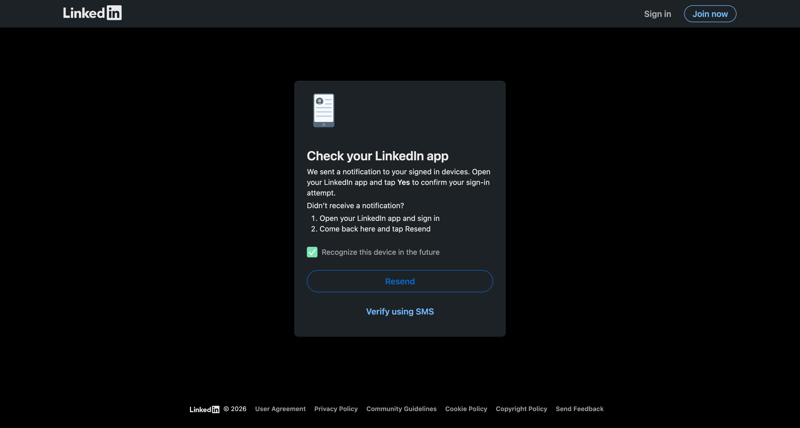
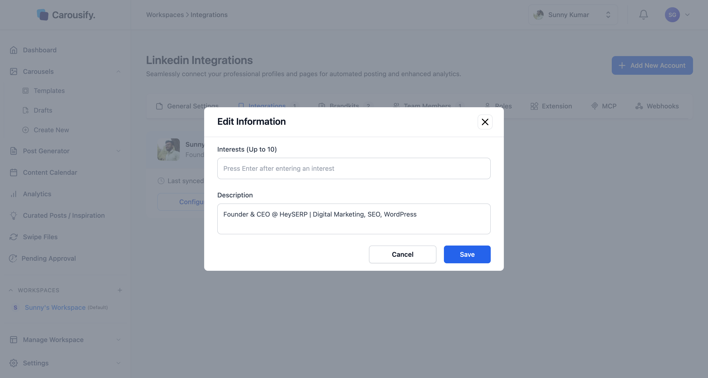
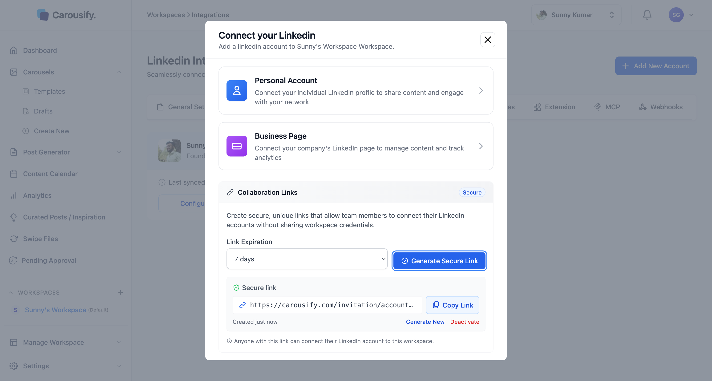

Carousify uses LinkedIn's official OAuth flow — you log in on LinkedIn, approve the permissions, and get redirected back. **We never see or store your password.**

You can connect your LinkedIn from two places:

- During [onboarding](/quickstart#step-3-%E2%80%94-connect-your-social-account), at step 3 (personal profiles only)
- Any time after, from **Manage Workspace › Social Integrations**

This page covers the post-onboarding flow. To connect Instagram instead, see [Connect your Instagram account](/getting-started/connect-instagram).

## Open the Social Integrations page

Go to **Manage Workspace › Social Integrations** in the left sidebar. If no account is connected yet, you'll see an empty state:

{/* SCREENSHOT NEEDED: images/connect-linkedin/integrations-empty.png — Manage Workspace › Social Integrations with no accounts connected: heading "Social Integrations", "Add New Account" button top right, "No account is connected" empty state with Connect Account and Learn More buttons. Replaces the existing image (old heading "Linkedin Integrations"). */}

Click **Add New Account** (top right) — or **Connect Account** in the empty state.

## Pick what to connect

The **Add New Account** dialog lists the platforms you can connect — **LinkedIn** and **Instagram** — with [Collaboration Links](#let-clients-connect-their-linkedin-without-sharing-logins) below.

{/* SCREENSHOT NEEDED: images/connect-linkedin/add-new-account-modal.png — Add New Account dialog on Manage Workspace › Social Integrations, showing the LinkedIn and Instagram platform cards, the OR divider, and the Collaboration Links section below */}

Click **LinkedIn**. The dialog switches to **Connect your LinkedIn** with two options:

{/* SCREENSHOT NEEDED: images/connect-linkedin/connect-modal.png — "Connect your LinkedIn" view of the same dialog (after clicking LinkedIn): Back link, Personal Account and Business Page cards, Collaboration Links section with Link Expiration "7 days" and Generate Secure Link. Replaces the existing image (old heading "Connect your Linkedin", no Back link). */}

<Columns cols={2}>
  <Card title="Personal Account" icon="user">
    Your individual LinkedIn profile. Used to publish posts and carousels under your name.
  </Card>
  <Card title="Business Page" icon="building">
    A LinkedIn company page you admin. Posts publish as the page, not as you.
  </Card>
</Columns>

<Note>
  Connecting **LinkedIn Pages** is a plan-specific feature. Personal accounts work on every paid plan; pages start on Startup and up. Every profile, page, and Instagram account counts toward your plan's connected-accounts limit. See [carousify.com/pricing](https://carousify.com/pricing/) for the breakdown.
</Note>

## Connect a personal account

<Steps>
  <Step title="Click Personal Account">
    Carousify opens LinkedIn's official sign-in page in the same tab.
  </Step>
  <Step title="Sign in to LinkedIn">
    

    Enter your LinkedIn email and password. If you're already signed in, LinkedIn skips this and goes straight to the permissions screen.
  </Step>
  <Step title="Approve permissions">
    LinkedIn shows the scopes Carousify is requesting (read profile, read connections size, post on your behalf, manage company pages you admin). Click **Allow**.
  </Step>
  <Step title="Add interests">
    Back in Carousify, add a few interests and a short description for the account. Carousify uses them to tune AI-generated content.
  </Step>
  <Step title="Land back in Social Integrations">
    Your account now appears in **Manage Workspace › Social Integrations** with your name, headline, avatar, and an **Active** status.

    {/* SCREENSHOT NEEDED: images/connect-linkedin/integrations-connected.png — Manage Workspace › Social Integrations page (heading "Social Integrations") with two connected accounts: a LinkedIn personal profile card ("Personal" chip, blue header) and an Instagram card (Instagram badge on the avatar, pink header), both showing "Active", "Last synced …", Configure and Disconnect. Replaces the existing image. */}
  </Step>
</Steps>

That's it — you can now schedule, publish, and pull analytics for that profile.

Connecting a **Business Page** works the same way: click **Business Page**, approve on LinkedIn, and pick the page you admin.

### Edit account info

Click **Configure** on a connected account to set interests (used to tune AI-generated content) and tweak the description Carousify uses for context:

## Let clients connect *their* LinkedIn — without sharing logins

This is the part that makes Carousify usable for agencies and ghostwriters.

<Info>
  **You never need your client's LinkedIn email or password.** Carousify generates a secure, one-time link your client opens themselves. They sign in on LinkedIn, approve the permissions, and the account lands in *your* workspace — fully managed by you, never touching your client's credentials.
</Info>

<Note>
  Collaboration Links connect **LinkedIn** accounts only. Instagram accounts have to be connected from inside the workspace.
</Note>

### Generate a Collaboration Link

In the **Add New Account** dialog (or the **Connect your LinkedIn** view), scroll to **Collaboration Links**:

<Steps>
  <Step title="Pick an expiry">
    Choose **24 hours**, **7 days**, or **30 days** under **Link Expiration**. The link stops working after that — even if no one used it.
  </Step>
  <Step title="Click Generate Secure Link">
    Carousify creates a unique URL bound to your workspace.

    
  </Step>
  <Step title="Send it to your client">
    Click **Copy Link** and share it however you like — email, Slack, WhatsApp. They don't need a Carousify account.
  </Step>
  <Step title="Client connects from their side">
    They open the link, click through LinkedIn's official OAuth, and approve permissions. Their account appears in *your* Social Integrations list as soon as they finish.
  </Step>
</Steps>

If you ever need to revoke access early, click **Deactivate** on the link — anyone who hasn't used it yet is locked out instantly. Use **Generate New** to create a fresh link without expiring the old one. Links that are still valid are listed under **Active Links**, where you can remove each one.

<Tip>
  Use shorter expiries (24h or 7d) for one-off onboarding. Use 30 days only when you know exactly when the client can sit down to do it.
</Tip>

## What Carousify can do once connected

- **Publish and schedule** carousels (as PDF documents), image posts, text posts, videos, and documents
- **Auto-plug** a follow-up comment on your own post after a delay
- **Pull analytics** — connections or followers, posts, and engagement — into [Analytics](/analytics/linkedin-analytics)
- **Track outbound links** with shortened, attributable URLs (Business plan and up)

## Reconnect an account

Carousify keeps LinkedIn and Instagram connections alive by refreshing them in the background. An account is only marked as disconnected when LinkedIn or Instagram actually rejects the connection — for example, after you change your password or remove Carousify from the apps connected to your account.

When that happens:

- The account card on **Manage Workspace › Social Integrations** shows **Inactive** instead of **Active**.
- A banner at the top of the app reads *A connected LinkedIn or Instagram account needs to be reconnected: Reconnect Now.*

To fix it:

<Steps>
  <Step title="Open Social Integrations">
    Click **Reconnect Now** in the banner, or go to **Manage Workspace › Social Integrations**.
  </Step>
  <Step title="Reconnect the inactive account">
    Click **Reconnect** on the inactive card. You can also click **Add New Account** and connect the same account again — Carousify recognises it and updates the existing connection instead of adding a duplicate.
  </Step>
  <Step title="Sign in with the same account">
    Sign in on LinkedIn (or Instagram) with the **same** account that shows as inactive, and approve the permissions. The card switches back to **Active**.
  </Step>
</Steps>

<Warning>
  Don't click **Disconnect** to fix an inactive account. Disconnecting removes the account and all of its data from the workspace, and it can't be undone. Reconnecting keeps everything.
</Warning>

While an account is inactive, scheduled posts for it can't publish — they fail and you get a **Failed to Publish Post** notification. After you reconnect, open **Post Generator › Published**, find the post under **Failed To Publish**, and publish or schedule it again.

## Disconnect an account

To remove an account for good, click **Disconnect** on its card in **Manage Workspace › Social Integrations** and confirm. This removes the account and all of its data from the workspace and can't be undone. To use the account again later, connect it again from scratch.

Adding and removing accounts needs the matching permissions in your [role](/workspaces/roles).
