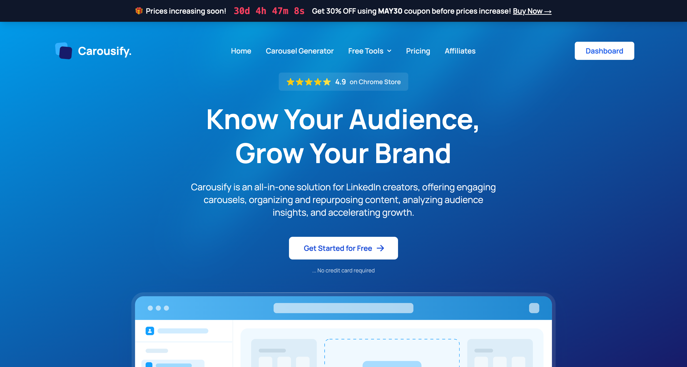

Carousify is a LinkedIn and Instagram growth platform for creators, agencies, and businesses. Build carousels with templates or AI, repurpose existing content into posts, publish and schedule to multiple LinkedIn and Instagram accounts from one post, and collaborate with your team — all using the platforms' official APIs.

## What you can do

<Columns cols={2}>
  <Card title="Build carousels" icon="layer-group" href="/carousel-maker/overview">
    Drag-and-drop builder, 45+ templates plus community templates, and AI generation in one editor.
  </Card>
  <Card title="Generate posts" icon="wand-magic-sparkles" href="/post-generator/overview">
    Turn voice notes, PDFs, YouTube videos, or articles into ready-to-publish posts.
  </Card>
  <Card title="Schedule and auto-plug" icon="calendar" href="/scheduling/schedule-post">
    Queue posts for LinkedIn and Instagram at peak times, and drop a follow-up comment on LinkedIn automatically after a set delay.
  </Card>
  <Card title="Run a team" icon="users" href="/workspaces/overview">
    Workspaces with member roles, client social accounts, and approval workflows.
  </Card>
</Columns>

## How to get started

<Steps>
  <Step title="Create your account">
    Sign up at [carousify.com](https://carousify.com/) and verify your email.
  </Step>
  <Step title="Customize your workspace">
    During onboarding, set your workspace name, timezone, and other preferences.
  </Step>
  <Step title="Connect your social accounts">
    Authorize Carousify through LinkedIn's or Instagram's official login. See [Connect LinkedIn](/getting-started/connect-linkedin) and [Connect Instagram](/getting-started/connect-instagram).
  </Step>
  <Step title="Set up your Brand Kit">
    Save your brand colors, fonts, and logos so every carousel matches. See [Brand Kit](/carousel-maker/brand-kit).
  </Step>
  <Step title="Choose a plan">
    Pick a plan on the [pricing page](https://carousify.com/pricing/) to unlock the core features.
  </Step>
</Steps>

<Note>
  You can skip plan selection during onboarding, but creating carousels, generating posts, scheduling, and publishing all require an active subscription.
</Note>

## For teams and agencies

<Columns cols={2}>
  <Card title="Brand Kit" icon="palette" href="/carousel-maker/brand-kit">
    Save brand colors, fonts, and logos so every carousel matches the brand.
  </Card>
  <Card title="Approval workflow" icon="circle-check" href="/workspaces/approval">
    Require manager review before posts publish. Available on Business and Enterprise.
  </Card>
  <Card title="Client accounts" icon="briefcase" href="/workspaces/clients">
    Connect multiple LinkedIn and Instagram accounts and manage client content centrally.
  </Card>
  <Card title="Link tracking" icon="link" href="/analytics/link-tracking">
    Shorten and track outbound links to measure click-through. Business and up.
  </Card>
</Columns>

## For developers

<Columns cols={3}>
  <Card title="Webhooks" icon="webhook" href="/webhooks/overview">
    Receive real-time events for new posts and approval state changes.
  </Card>
  <Card title="MCP server" icon="robot" href="/mcp/overview">
    Drive Carousify from Claude, Codex, VS Code, or Antigravity.
  </Card>
  <Card title="Whitelabel" icon="building" href="/whitelabel/overview">
    Run Carousify under your own brand and domain on Enterprise plans.
  </Card>
</Columns>

<Note>
  Carousify uses LinkedIn's and Instagram's official APIs. We never ask for your password and stay compliant with each platform's terms of service.
</Note>
