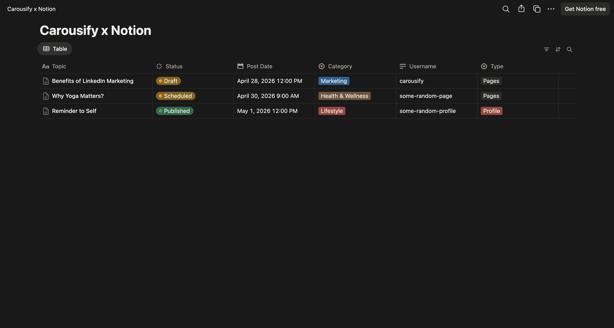
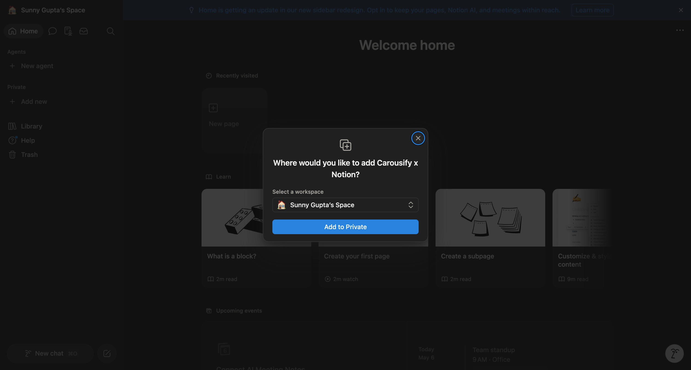
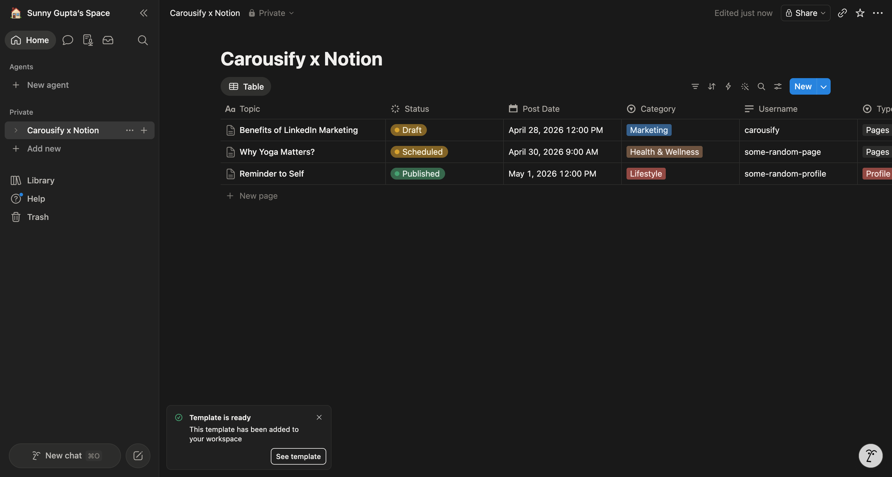
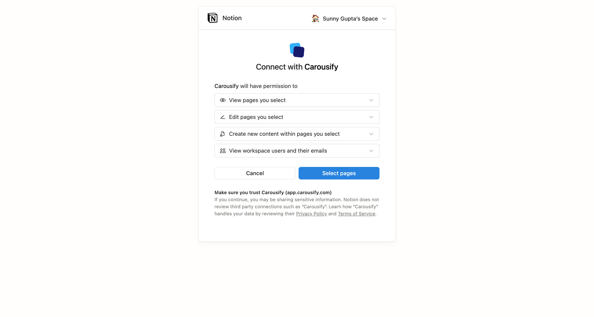
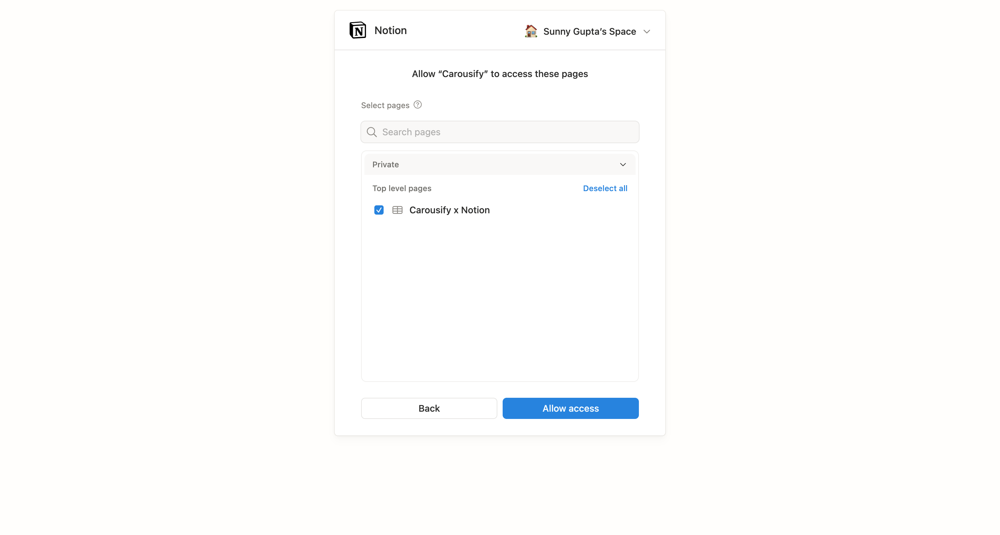
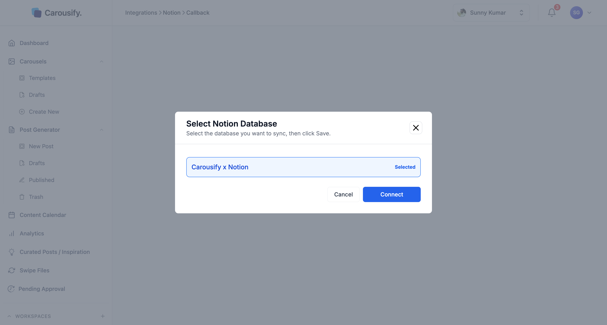
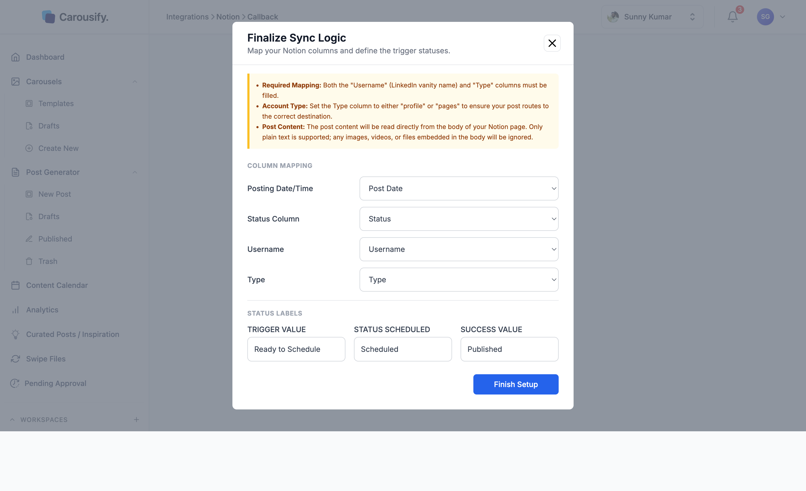

The Notion integration lets you plan, draft, and schedule LinkedIn posts inside a Notion database. When a row's status hits your trigger value, Carousify reads the page body, schedules it for the date you set, and publishes it to the LinkedIn profile or page you named — all without leaving Notion.

This is the cleanest setup for teams who already do their planning in Notion: writers draft in a row, an editor flips the status, and Carousify takes it from there.

<Note>
  Carousify uses Notion's official OAuth and only accesses the pages you explicitly select. We never read pages outside the database you connect.
</Note>

<Note>
  Notion scheduling posts text-only posts to **LinkedIn** profiles and pages. To post to Instagram, or to attach images, videos, or carousels, schedule from inside Carousify — see [Schedule a post](/scheduling/schedule-post).
</Note>

## What Carousify can access

When you authorize the integration, Notion shows the exact permissions Carousify is requesting:

- **View pages you select** — read the database rows and post body text
- **Edit pages you select** — update the status column when Carousify schedules a post
- **Create new content within pages you select** — not used
- **View workspace users and their emails** — not used; posts scheduled from Notion are created under the Carousify workspace owner

Carousify only sees the database (and rows inside it) you tick during the OAuth step. Pages outside that selection stay invisible to us.

## Before you start

You'll need:

- A Notion workspace where you have permission to add pages
- A connected LinkedIn profile or page in Carousify — see [Connect your LinkedIn account](/getting-started/connect-linkedin)
- A **timezone** set on the workspace (**Manage Workspace › General**) — Carousify reads Notion dates in that timezone and skips rows when none is set
- A plan that includes integrations, and a role that can manage them
- 5 minutes

## Step 1 — Open the Connect Notion Workspace dialog

In Carousify, go to **Manage Workspace › Integrations** in the left sidebar and click **Connect** on the Notion card.

{/* SCREENSHOT NEEDED: images/integrations/notion-connect-modal.png — Connect Notion Workspace dialog (subheading "Easily sync content and manage your social pipeline directly from Notion.") with Copy Notion Template, View Notion Setup Guide and the blue Continue with Notion button. Replaces the existing image, which shows the old "Authenticate with Notion" button. */}

The modal has three actions:

| Button | What it does |
| --- | --- |
| **Copy Notion Template** | Opens the Carousify-ready Notion template so you can duplicate it into your workspace. |
| **View Notion Setup Guide** | Opens this page. |
| **Continue with Notion** | Starts the Notion OAuth flow. |

If you already have a database you want to use, skip to [Step 3](#step-3-%E2%80%94-or-use-your-own-database). Otherwise start at Step 2.

## Step 2 — Copy the Notion template

Click **Copy Notion Template** in the Carousify modal — it opens the [Carousify x Notion template](https://lofty-limburger-811.notion.site/358853573c2d80afb3b1cf08d549b69c?v=358853573c2d80ad9ee3000c87b7a782) in a new tab. The template is a public, read-only Notion page with a database called **Carousify x Notion** that has every column Carousify needs.

In the top-right corner of the Notion page, click the **Duplicate** icon (the square with an arrow, just to the left of the three-dot **More actions** menu).

Notion opens a **Duplicate template** modal. Pick the Notion workspace you want to add it to, then click **Add to Private**.

After a few seconds Notion shows a **Template is ready** toast and the **Carousify x Notion** database appears in the **Private** section of your sidebar.

<Tip>
  You can rename the database, add columns, change views, or move it into any folder. Carousify only cares about the columns you map in Step 5.
</Tip>

## Step 3 — Or use your own database

Don't want our template? Any Notion database works as long as it has these column types:

| Carousify field | Notion column type | What goes in it |
| --- | --- | --- |
| **Posting Date/Time** | Date, with a time included | When the post should publish, in your workspace timezone. Dates without a time are skipped. |
| **Status** | Status or Select | Drives the workflow — see [Status labels](#status-labels) below. |
| **Username** | Text or Select | The LinkedIn vanity name (e.g. `carousify`) of the profile or page to publish from. |
| **Type** | Text or Select | `profile` or `pages` — tells Carousify whether to post to a personal profile or a company page. |

The post **body** lives inside the Notion page itself (open the row to write it). Column names can be anything — you'll map them in Step 5.

## Step 4 — Continue with Notion

Back in Carousify, click **Continue with Notion** in the same dialog. Notion opens its official **Connect with Carousify** screen showing the requested permissions.

Click **Select pages**, then tick the database you want Carousify to read — **Carousify x Notion** if you used the template, or your own database if you built one.

Click **Allow access**. Notion redirects you back to Carousify.

<Warning>
  Only tick the database you actually want to publish from. Anything else you select gives Carousify read access it doesn't need.
</Warning>

## Step 5 — Pick the database

Carousify lands on the **Select Notion Database** screen with every database you authorized listed. Click the one you want to use so it's highlighted.

Click **Connect** to move on.

<Note>
  A Notion database can be connected to only one Carousify workspace at a time. If it's already connected elsewhere, Carousify says so — disconnect it there first.
</Note>

## Step 6 — Map columns and define statuses

The **Finalize Sync Logic** screen is where you tell Carousify which Notion column means what. If you're using our template, the values in the **Column Mapping** dropdowns line up 1-to-1 with the column names.

### Column mapping

| Carousify field | Map to (template default) |
| --- | --- |
| **Posting Date/Time** | `Post Date` |
| **Status Column** | `Status` |
| **Username** | `Username` |
| **Type** | `Type` |

If you built your own database, pick the matching columns from each dropdown.

### Status labels

This is the workflow contract — three values that tell Carousify what your status column says at each stage.

| Field | What it means | Suggested value |
| --- | --- | --- |
| **Trigger Value** | Carousify picks up the row when **Status** changes to this. | `Ready to Schedule` |
| **Status Scheduled** | Carousify writes this back to the row once the post is scheduled. | `Scheduled` |
| **Success Value** | The status your team uses for posts that are live. Carousify leaves rows with this status alone. | `Published` |

You can use any values you want — they need to match the options in your Notion **Status** column exactly (case-sensitive), and each one must exist as an option in that column.

<Note>
  **Required:** the **Username** and **Type** columns on every row you want to publish must be filled. **Username** is the LinkedIn vanity name — the bit after `linkedin.com/in/` for profiles or `linkedin.com/company/` for pages. **Type** must be `profile` or `pages`.
</Note>

<Note>
  **Post content:** Carousify reads the post body straight from the body of the Notion page (open the row to edit it). It reads paragraphs, headings, and bulleted and numbered list items as plain text, with a blank line between blocks. Formatting, images, videos, files, and other block types are ignored.
</Note>

Click **Finish Setup**. Carousify redirects you back to **Integrations** with Notion now showing as **Active**. Click **View** on the Notion card any time to see your mapping and status labels.

## How posts actually publish

Once the integration is live, here's the loop on every row:

<Steps>
  <Step title="You set the status to your trigger value">
    Pick a row, fill in **Username**, **Type**, **Post Date** (with a time), write the body of the page, and change **Status** to the trigger value (e.g. `Ready to Schedule`).
  </Step>
  <Step title="Carousify reads the row">
    Notion tells Carousify the row changed — usually within a few minutes. Carousify reads the page body and schedules a post for the date and time in **Post Date**, on the profile or page whose vanity name matches **Username** and **Type**.
  </Step>
  <Step title="Carousify writes Scheduled back">
    The **Status** column updates to your **Status Scheduled** value (e.g. `Scheduled`). The post also appears in the Carousify [Content Calendar](/scheduling/calendar).
  </Step>
  <Step title="Carousify publishes at the scheduled time">
    At **Post Date**, Carousify publishes the post to LinkedIn. It then shows up under [Published](https://app.carousify.com/published/) in Carousify.
  </Step>
</Steps>

<Note>
  Carousify doesn't change the Notion status after the post publishes. If you track published posts in Notion, set the row to your **Success Value** yourself — Carousify ignores rows with that status.
</Note>

If a row can't be scheduled — the date has no time or is in the past, **Username** or **Type** is empty or doesn't match a connected profile or page, or the workspace has no timezone — Carousify skips it and leaves the status at your trigger value. Fix the row, then set the status to the trigger value again.

### Change or cancel a scheduled row

- **Change it** — edit the body or **Post Date**, then set **Status** back to the trigger value. Carousify updates the existing scheduled post instead of creating a second one.
- **Cancel it** — change **Status** to anything other than your trigger, scheduled, or success values (e.g. `Draft`), or move the page to the Notion trash. Carousify removes the scheduled post.

<Tip>
  Leave at least **5 minutes** between setting the trigger value and the **Post Date**. Notion can take a few minutes to notify Carousify, and rows whose **Post Date** is already less than a minute away when Carousify reads them are skipped.
</Tip>

## Disconnect or reconnect

To disconnect Notion, go to **Manage Workspace › Integrations**, click **Disconnect** on the Notion card, and confirm. Carousify stops reading the database. Posts it already scheduled from Notion stay in your [Content Calendar](/scheduling/calendar) — delete them there if you don't want them to publish. Your Notion rows, statuses, and history aren't touched.

To also remove Carousify's access on the Notion side, open Notion's **Settings › Connections** and disconnect **Carousify**.

To reconnect later — or to point Carousify at a different database — click **Connect** and run through the flow again. You'll go back through Notion's OAuth consent, the database picker, and the column mapping.

<Tip>
  Re-running OAuth is also how you grant access to a *different* page after the fact. Notion only shows pages you ticked during the original consent, so adding a new one means going back through **Allow access**.
</Tip>

## Troubleshooting

- **A row never picks up.** Check that **Status** matches your **Trigger Value** exactly (case-sensitive), **Username** and **Type** are both filled, **Post Date** includes a time and is in the future, and the workspace has a timezone set under **Manage Workspace › General**.
- **The LinkedIn profile or page isn't found.** The account must be connected in this workspace's **Social Integrations** and not disconnected. Reconnect it there if it shows as disconnected.
- **Post won't schedule.** **Username** and **Type** have to match — a personal profile vanity name needs **Type** set to `profile`, and a company page vanity needs **Type** set to `pages`. Mixing them (e.g. a personal vanity with `pages`) means Carousify can't find a matching connected account and the post silently won't get scheduled.
- **My images aren't posting.** Carousify reads only plain text from the Notion page body today. To attach media, schedule from inside Carousify instead — see [Schedule a post](/scheduling/schedule-post).
- **The integration shows as Active but nothing syncs.** Open Notion, click the database name, and make sure the **Carousify** integration is still in the **Connections** list (top-right `…` menu › **Connections**). If it's gone, reconnect from Carousify.

## What's next

<Columns cols={2}>
  <Card title="Schedule a post" icon="calendar" href="/scheduling/schedule-post">
    Schedule directly inside Carousify when you don't need Notion in the loop.
  </Card>
  <Card title="Content Calendar" icon="calendar-days" href="/scheduling/calendar">
    See every Notion-scheduled post alongside posts queued from Carousify itself.
  </Card>
  <Card title="Slack notifications" icon="slack" href="/integrations/slack">
    Get pinged when a Notion-scheduled post publishes or fails.
  </Card>
  <Card title="MCP server" icon="robot" href="/mcp/overview">
    Drive Carousify from Claude or VS Code when Notion isn't enough.
  </Card>
</Columns>
