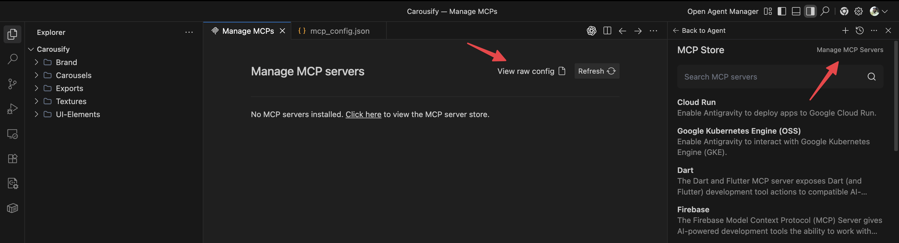

[Antigravity](https://antigravity.google/) is Google's agent-first IDE. It supports remote MCP servers, so once Carousify is added, the agent can draft posts, build carousels, schedule them, and pull analytics as part of any task.

## Before you start

- A Carousify workspace on a plan with MCP access, and a role that can create MCP keys. See [Before you start](/mcp/overview#before-you-start).
- Antigravity installed and signed in.

## Step 1: Create an MCP key

In Carousify, open **Manage Workspace › MCP**. Type a label in **API Name** (for example `antigravity`) and click **Create API Key**, or click **Enable MCP** if MCP isn't enabled yet. Copy the MCP URL that appears:

```
https://api.carousify.com/mcp?token=YOUR_MCP_KEY
```

The **Antigravity** tab on the same page shows the config entry with this URL.

<Warning>
  Carousify shows the full key only once. Treat it like a password: anyone with it can use your workspace with your role's permissions.
</Warning>

## Step 2: Add Carousify in Antigravity

<Steps>
  <Step title="Open Manage MCP Servers">
    In the agent panel, open the **…** menu, choose **MCP Servers**, then click **Manage MCP Servers**. (Older versions: click **Open Agent Manager** in the top-right, then **Manage MCP Servers**.)

    
  </Step>
  <Step title="Open the raw config">
    Click **View raw config**. Antigravity opens `mcp_config.json`.
  </Step>
  <Step title="Add Carousify and save">
    Add a `carousify` entry under `mcpServers` with the URL from Step 1 as `serverUrl`:

    ```json
    {
      "mcpServers": {
        "carousify": {
          "serverUrl": "https://api.carousify.com/mcp?token=YOUR_MCP_KEY"
        }
      }
    }
    ```

    If you prefer to keep the key out of the URL, send it as a header instead:

    ```json
    {
      "mcpServers": {
        "carousify": {
          "serverUrl": "https://api.carousify.com/mcp",
          "headers": { "Authorization": "Bearer YOUR_MCP_KEY" }
        }
      }
    }
    ```

    {/* SCREENSHOT NEEDED: images/mcp/antigravity-mcp-config.png — mcp_config.json open in Antigravity with the carousify entry, serverUrl "https://api.carousify.com/mcp?token=YOUR_MCP_KEY" (placeholder, not a real key). Replaces the existing image, which shows the old app.carousify.com/api/mcp URL. */}

    Save the file (`⌘ S` / `Ctrl S`), then click **Refresh** on the **Manage MCPs** tab to confirm Carousify shows up with its tools.
  </Step>
</Steps>

## Step 3: Use it from the agent

Start an agent task and try:

- *"Using Carousify, draft a LinkedIn post about this release and schedule it for tomorrow at 9 AM."*
- *"List the posts I have scheduled in Carousify this week."*
- *"Pull Carousify analytics for my last published post."*

The agent asks you to confirm actions before running them. See the [tools reference](/mcp/tools).

## Disconnect or rotate

- **Disconnect:** open **Manage MCP Servers › View raw config**, remove the `carousify` entry and save.
- **Rotate the key:** in Carousify, delete the key in the **MCP Keys** table, create a new one, and update `mcp_config.json`.

## Troubleshooting

- **Connection fails.** The key is wrong, turned off or deleted. Check it shows as on in **MCP Keys**, and that you used the full key, not the masked `XXXX…` version.
- **The agent can't find Carousify tools.** Click **Refresh** on the **Manage MCPs** tab so Antigravity reloads the config.
- **Wrong workspace.** MCP keys belong to one workspace. Create a key in the workspace you want and update the config.
- **Older setups:** if the config points at `app.carousify.com/api/mcp`, change it to `https://api.carousify.com/mcp`.

## What's next

<Columns cols={2}>
  <Card title="Tools reference" icon="screwdriver-wrench" href="/mcp/tools">
    What the agent can do in Carousify.
  </Card>
  <Card title="Permissions and security" icon="shield-halved" href="/mcp/permissions">
    How your role applies to MCP keys.
  </Card>
</Columns>
