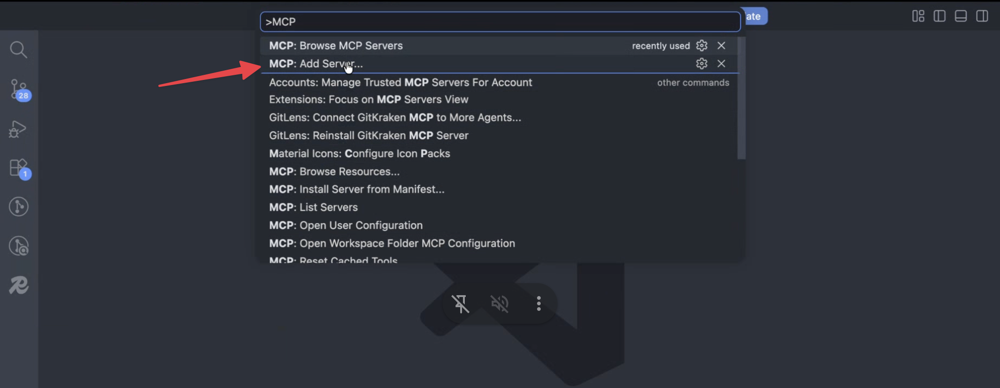
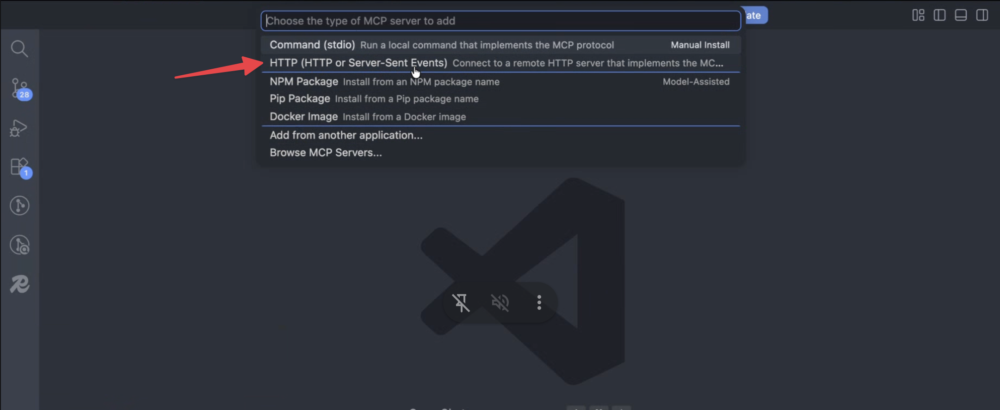

VS Code's chat supports remote MCP servers out of the box. Add Carousify with your MCP key and you can draft a post, build a carousel, schedule it, or pull analytics from the chat panel. No extension needed.

## Before you start

- A Carousify workspace on a plan with MCP access, and a role that can create MCP keys. See [Before you start](/mcp/overview#before-you-start).
- VS Code 1.102 or later, with chat (GitHub Copilot) set up.

## Step 1: Create an MCP key

In Carousify, open **Manage Workspace › MCP**. Type a label in **API Name** (for example `vscode`) and click **Create API Key**, or click **Enable MCP** if MCP isn't enabled yet. Copy the MCP URL that appears:

```
https://api.carousify.com/mcp?token=YOUR_MCP_KEY
```

<Warning>
  Carousify shows the full key only once. Treat it like a password: anyone with it can use your workspace with your role's permissions.
</Warning>

## Step 2: Add Carousify in VS Code

<Steps>
  <Step title="Run MCP: Add Server">
    Open the Command Palette (`⌘ Shift P` / `Ctrl Shift P`), type `MCP`, and pick **MCP: Add Server**.

    
  </Step>
  <Step title="Choose HTTP">
    Pick **HTTP (HTTP or Server-Sent Events)**. Carousify is a remote server, not a local command.

    
  </Step>
  <Step title="Paste the URL and name it">
    Paste the MCP URL from Step 1 and press **Enter**. Enter `carousify` as the server ID, then choose where to save it (for yourself on all projects, or for this workspace only).

    {/* SCREENSHOT NEEDED: images/mcp/vscode-server-url.png — VS Code "Enter Server URL" prompt with https://api.carousify.com/mcp?token=YOUR_MCP_KEY typed in (use the placeholder, not a real key). Replaces the existing image, which shows the old app.carousify.com/api/mcp URL. */}
  </Step>
</Steps>

VS Code starts the server and lists Carousify's tools. Run **MCP: List Servers** to check that Carousify is running.

### Keep the key out of the file

If you save the server in a workspace configuration that's shared or committed, don't put the key in the URL. In a `.vscode/mcp.json` file, let VS Code ask for the key once and store it securely:

```json
{
  "servers": {
    "carousify": {
      "type": "http",
      "url": "https://api.carousify.com/mcp",
      "headers": { "Authorization": "Bearer ${input:carousify-key}" }
    }
  },
  "inputs": [
    {
      "type": "promptString",
      "id": "carousify-key",
      "description": "Carousify MCP key",
      "password": true
    }
  ]
}
```

## Step 3: Use it in chat

Open the chat panel, make sure the Carousify tools are enabled (**Configure Tools** in the chat input), and try:

- *"Using Carousify, draft a LinkedIn post recapping today's release and schedule it for 9 AM tomorrow."*
- *"List my scheduled Carousify posts for this week."*
- *"Turn CHANGELOG.md into a Carousify carousel using one of my templates."*

VS Code asks you to approve tool calls before they run. See the [tools reference](/mcp/tools) for what each tool does.

## Disconnect or rotate

- **Disconnect:** run **MCP: List Servers**, select **carousify** and remove it, or delete its entry from your MCP configuration file.
- **Rotate the key:** in Carousify, delete the key in the **MCP Keys** table, create a new one, and update the URL or input in VS Code.

## Troubleshooting

- **The server fails to start with 401 "Invalid API key!"** The key is wrong, turned off or deleted. Check it shows as on in **MCP Keys**, and that you pasted the full key, not the masked `XXXX…` version.
- **"This MCP key was created by someone who is no longer in this workspace."** Create a new key.
- **The URL starts with `app.carousify.com/api/mcp`.** That's from an older guide. Use `https://api.carousify.com/mcp`.

## What's next

<Columns cols={2}>
  <Card title="Tools reference" icon="screwdriver-wrench" href="/mcp/tools">
    What the assistant can do in Carousify.
  </Card>
  <Card title="Permissions and security" icon="shield-halved" href="/mcp/permissions">
    How your role applies to MCP keys.
  </Card>
</Columns>
