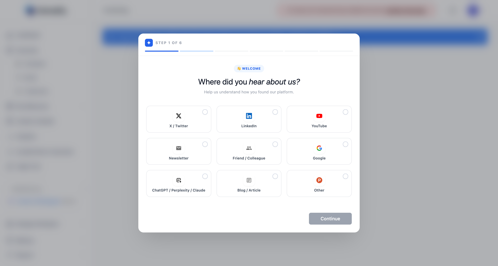
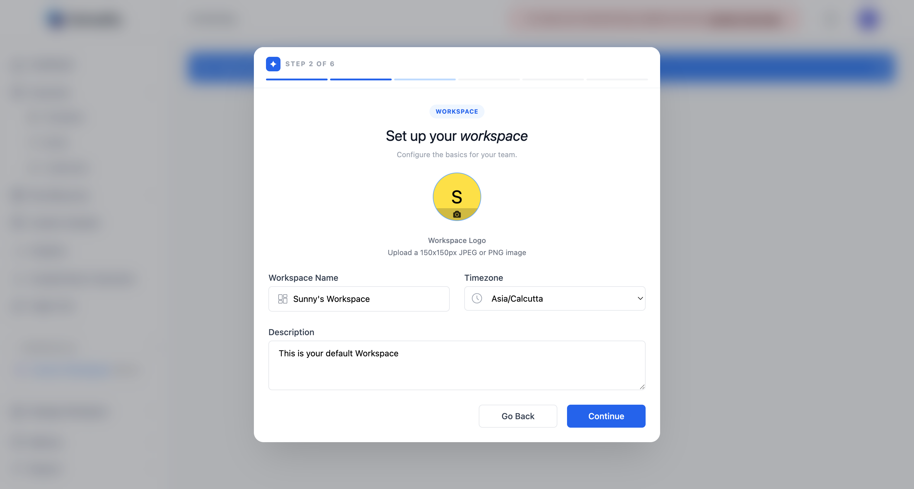
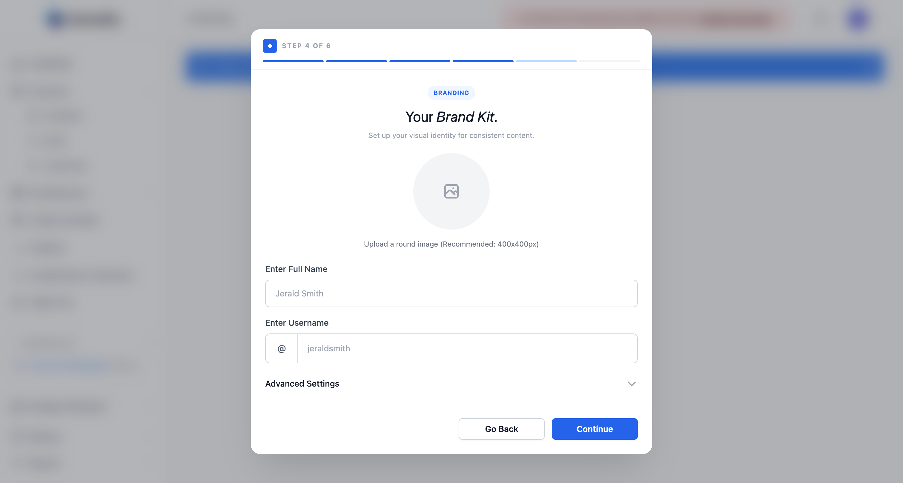
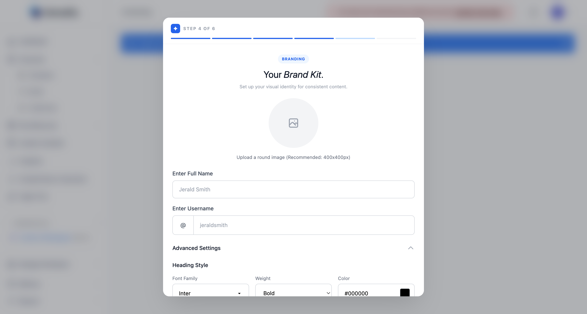
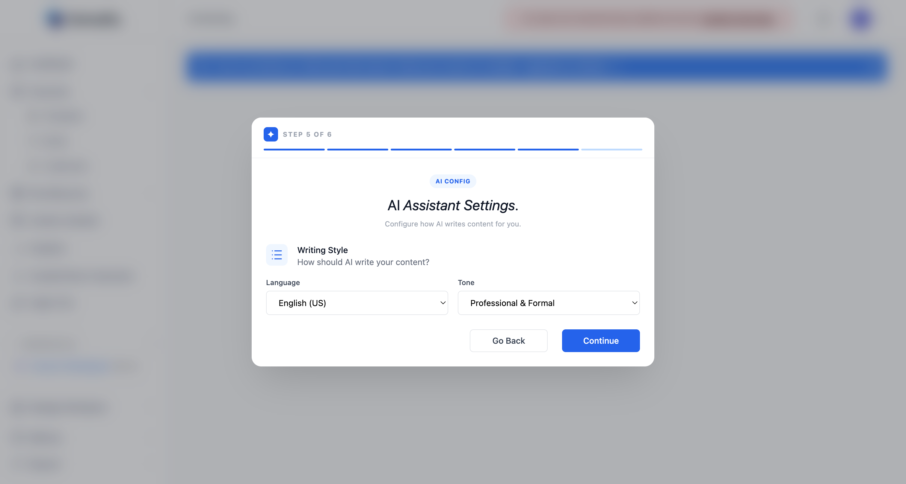
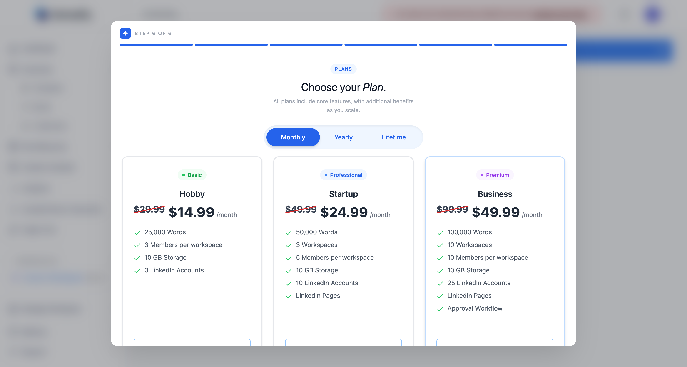

This guide walks you through every screen of the Carousify onboarding so you know exactly what to expect.

<Note>
  You'll need a LinkedIn account or an Instagram Business or Creator account, and a credit or debit card. Carousify requires an active subscription to publish, schedule, or generate content — onboarding lets you skip plan selection, but the core features stay locked until you pick one.
</Note>

## Before you start

<Steps>
  <Step title="Create your account">
    Sign up at [carousify.com](https://carousify.com/) using your email, Google, or LinkedIn.
  </Step>
  <Step title="Verify your email">
    Click the verification link Carousify sends you. You'll land on the onboarding flow automatically after verifying.
  </Step>
</Steps>

## Step 1 — Tell us where you heard about us

Pick the channel that brought you to Carousify (X / Twitter, LinkedIn, YouTube, a friend or colleague, Google, an AI assistant such as ChatGPT, a blog or article, or Other). It's a single click — this only helps the team understand which channels work, and doesn't change your account in any way.

Click **Continue** to move on.

## Step 2 — Set up your workspace

Your workspace is where every carousel, post, draft, and team member lives. Carousify pre-fills a default name based on your sign-up.

| Field | What to enter |
| --- | --- |
| Workspace logo | Optional. 150×150px JPEG or PNG. |
| Workspace name | The name your team will see in the sidebar. |
| Timezone | Used for scheduled posts and the daily analytics sync. Set this to where you (or your audience) actually are. |
| Description | Optional one-liner describing the workspace. |

<Tip>
  You can rename the workspace later from **Workspace › General**. Timezone is the one setting worth getting right now — it controls when scheduled posts go live.
</Tip>

Click **Continue**.

## Step 3 — Connect your social account

{/* SCREENSHOT NEEDED: images/quickstart/step-3-social.png — Onboarding step 3 of 6, "Connect your Social account": the LinkedIn Personal Account block with a Connect LinkedIn button, the Instagram Account block with a Connect Instagram button, the "Want to connect a LinkedIn Page instead?" hint, Skip for now, Go Back and Continue. Replaces images/quickstart/step-3-linkedin.png. */}

Connect the account you'll post from. You can connect one here and add more later.

- **Connect LinkedIn** — authorize Carousify through LinkedIn's official OAuth flow for your personal profile.
- **Connect Instagram** — sign in with Instagram to connect a **Business** or **Creator** account. Personal Instagram accounts can't be connected. See [Connect your Instagram account](/getting-started/connect-instagram).

You're redirected to LinkedIn or Instagram, asked to confirm permissions, and sent back to onboarding, where you can add a few interests for the account to tune AI-generated content.

<Info>
  Carousify only uses the official LinkedIn and Instagram APIs. We never ask for your password and never automate actions that violate either platform's terms.
</Info>

Want to connect a LinkedIn **Page** instead of a personal profile? Skip this step and add the page later from **Manage Workspace › Social Integrations**. For more detail, see [Connect your LinkedIn account](/getting-started/connect-linkedin).

You can also click **Skip for now** and connect later — but you won't be able to publish until at least one account is linked.

## Step 4 — Set up your Brand Kit

Your Brand Kit is the identity Carousify uses on every carousel slide — author photo, name, handle, fonts, and colors. Filling it in once means every template you use afterwards already looks like *your* brand.

| Field | What to enter |
| --- | --- |
| Profile image | Round image, 400×400px recommended. If you connected an account in step 3, Carousify fills in its profile picture and name for you. |
| Full name | The name shown on the carousel as the author. |
| Username | Your @handle (no `@` needed; Carousify adds it). |

Open **Advanced Settings** to set the default heading, subheading, body, and background styles for every new carousel:

Pick a font family, weight, and color for each text level, plus a default slide background color.

<Tip>
  Don't overthink this — defaults are fine, and you can edit any individual slide later. The point is to have *one* consistent look so you're not picking fonts every time.
</Tip>

Click **Continue**.

## Step 5 — Configure the AI assistant

Set the defaults for AI-generated copy across the Post Generator, AI carousels, and the AI assistant inside the editor.

| Field | Options |
| --- | --- |
| Language | English (US/UK) plus 90+ other languages. |
| Tone | Professional & Formal, Conversational & Friendly, Technical & Detailed, or Inspirational & Motivating. |

You can override either of these per generation later — this is just the default.

Click **Continue**.

## Step 6 — Choose a plan

Pick a billing cycle (Monthly or Yearly) and a plan tier:

<Columns cols={2}>
  <Card title="Hobby" icon="user">
    Solo creators. 25,000 AI words, 3 social accounts, 10 GB storage.
  </Card>
  <Card title="Startup" icon="rocket">
    Small teams. 50,000 words, 3 workspaces, 5 members each, LinkedIn Pages.
  </Card>
  <Card title="Business" icon="building">
    Growing teams. 100,000 words, 10 workspaces, 25 social accounts, approval workflow.
  </Card>
  <Card title="Enterprise" icon="briefcase">
    Custom limits, whitelabeling, webhooks, advanced analytics. Contact sales.
  </Card>
</Columns>

Click **Select Plan** on the tier you want, then **Continue** to enter payment details.

If you signed up through an AppSumo deal, this step is skipped.

<Note>
  Onboarding lets you finish without picking a plan, but creating carousels, generating posts, scheduling, and publishing all stay locked until you have an active subscription. See [Plans and limits](/billing/plans) for the full breakdown.
</Note>

## You're done

You'll land on the **Dashboard**. From here:

<Columns cols={3}>
  <Card title="Make your first carousel" icon="layer-group" href="/carousel-maker/create">
    Pick a template or design one from scratch.
  </Card>
  <Card title="Generate a post" icon="wand-magic-sparkles" href="/post-generator/write-post">
    Turn an idea, voice note, or article into a ready-to-publish post.
  </Card>
  <Card title="Schedule a post" icon="calendar" href="/scheduling/schedule-post">
    Queue your first post at a peak time for your timezone.
  </Card>
</Columns>
