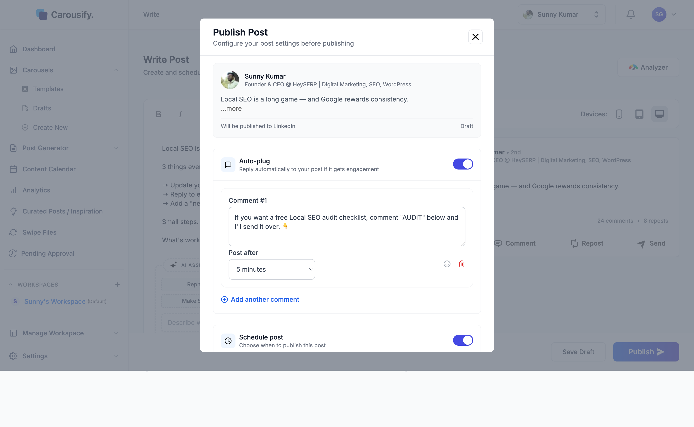

Auto-plug lets you queue one or more **follow-up comments** that Carousify drops on your own post a set number of minutes or hours after it goes live. The first hour of a LinkedIn post is critical for reach, and a self-comment with a link, lead magnet, or hook keeps the conversation going without you needing to be online when the post publishes.

<Note>
  Auto-plug is **not** an auto-reply to other people's engagement. It's a scheduled comment from you, on your own post. The post still goes out clean — the follow-up just shows up later.
</Note>

<Note>
  Auto-plug is available for **LinkedIn** posts only. If a post goes only to Instagram, the toggle shows **Coming soon on IG**. If it goes to both, the comments are posted on LinkedIn only.
</Note>

## Turn auto-plug on

Auto-plug lives in the same **Publish Post** dialog as scheduling. After you click **Publish** in the editor, flip the **Auto-plug** toggle on.

You'll see two fields:

- **Comment** — what Carousify will post under your post
- **Post after** — the delay. Pick a preset (**5m**, **15m**, **30m**, **1h**, **2h**, or **4h**) or type your own number of minutes or hours.

## Write the follow-up comment

Use the comment for whatever the post itself shouldn't carry — a link to your blog, a lead magnet, a "DM me" call to action, or a related resource:

- *"Free Local SEO audit checklist — comment AUDIT and I'll send it over."*
- *"Full breakdown on the blog: example.com/post"*
- *"Want the template? Drop a 🙋 below."*

Click **Add another comment** if you want to chain more self-comments after longer delays — up to three comments per post.

## Combine with scheduling

Auto-plug works whether you publish immediately or [schedule](/scheduling/schedule-post). The delay always counts from the moment the post actually goes live, not from when you set it up.
