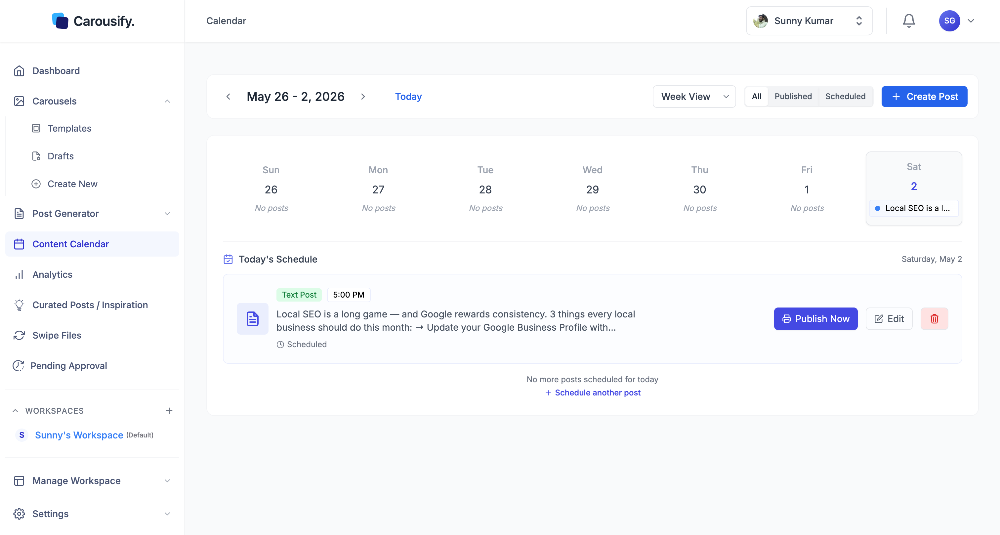

The **Content Calendar** is your single view of everything that's posted, scheduled, or planned across your workspace — LinkedIn and Instagram posts alike. Open it from **Content Calendar** in the left sidebar.

Switch between **Month View** and **Week View** from the dropdown at the top, jump back with **Today**, and use the **All / Published / Scheduled** buttons to filter the grid. Days and times follow the workspace timezone.

The right-hand **Today's Schedule** panel lists every post queued for the current day with its time, type, and quick actions — **Publish Now** or **Edit**. Click any day on the grid to focus the panel on that day instead. Below it, **Upcoming Scheduled Posts** lists what's queued next. Click **Create Post** to start a new post.
