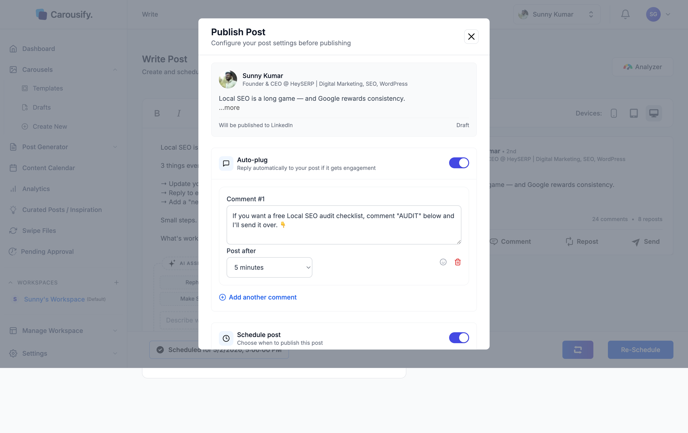
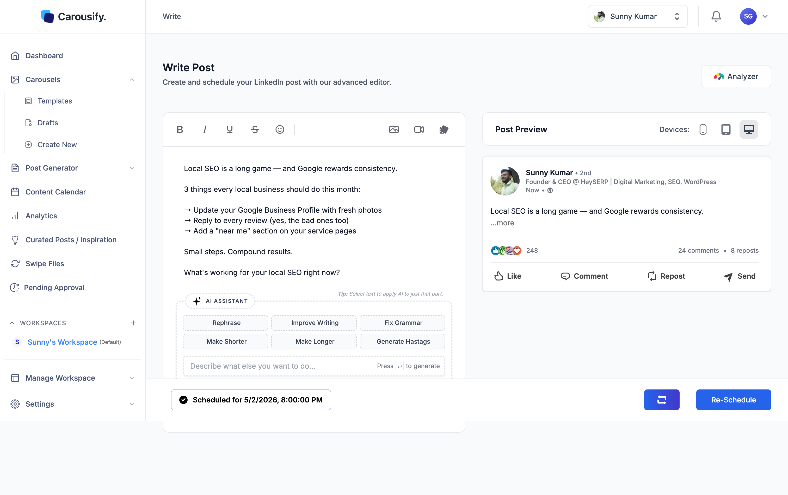

Already scheduled a post but want to push it back, pull it forward, or move to a different day? Use **Re-Schedule** instead of canceling and starting over.

## Open the post

There are two ways in:

- From **Content Calendar**, click the scheduled post and pick **Edit**, or
- Open it from **Post Generator › Upcoming**, which lists every scheduled post

You'll land in the writer with a **Scheduled for [date, time]** strip at the bottom and a **Re-Schedule** button next to it.

## Click Re-Schedule

Clicking **Re-Schedule** opens the same publish dialog you used originally — pre-filled with the existing date, time, and any auto-plug settings.

Change the date or time (in this example, from **5:00 PM** to **8:00 PM**), then click **Re-Schedule** at the bottom of the dialog. The same limits apply as when scheduling: at least 5 minutes and at most 8 days ahead, in the workspace timezone.

To post it right away instead, turn **Schedule post** off and click **Publish Now**.

## Confirm

Carousify updates the queue and shows a **Post updated successfully** toast. The strip at the bottom of the editor now reflects the new time:

The change shows up immediately in **Content Calendar** too — the post moves to the new slot.
