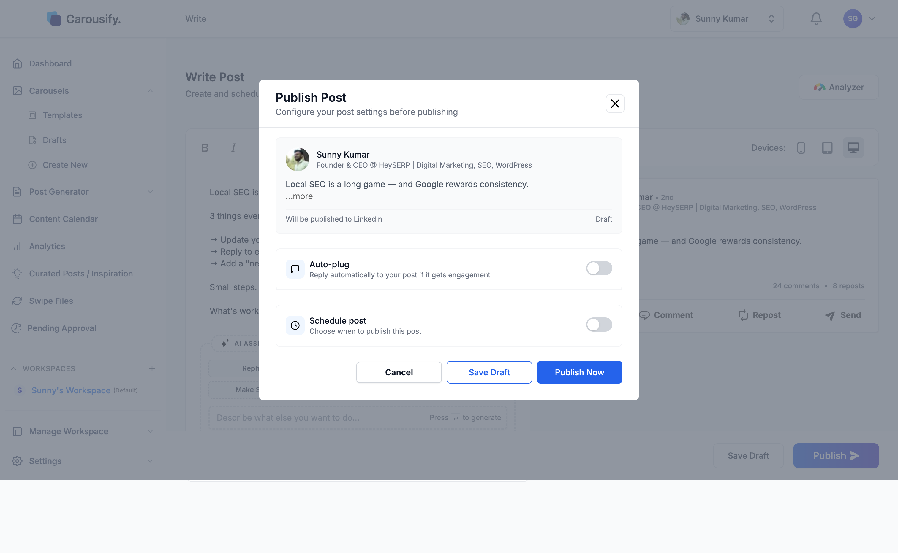
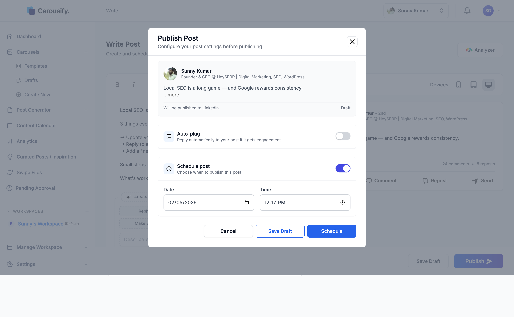

Carousify can publish your post immediately or queue it for a future date and time. Scheduling lives inside the same **Publish** flow you use for instant posts — no separate scheduler. One post can go to several LinkedIn and Instagram accounts at once.

## Write your post and pick the accounts

Open **Post Generator › New Post › Write New Post** (or any other starting point in the [Post Generator](/post-generator/overview)) and write your content in the editor. The right side shows a live LinkedIn or Instagram preview as you type.

Under **Publish to** at the top of the page, select every account the post should go to — LinkedIn profiles, LinkedIn pages, and Instagram accounts. If the post breaks a platform's rules (for example, an Instagram post without an image or video, or text over the limit), that platform is flagged and Carousify won't publish until it's fixed. See [platform limits](/post-generator/write-post#pick-the-accounts).

Once you're happy with the copy, click **Publish** in the bottom-right.

## Customize per account (two or more accounts)

If you picked two or more accounts, Carousify first opens **Review & Customize**, listing each account's version of the post. Each one starts as **Original** — the text and media from the editor.

Click an account to change its text or media without affecting the others — for example, a shorter caption and square images for Instagram, and a PDF carousel for LinkedIn. Edited accounts are marked **Customized**; click **Reset to original** to undo. Click **Continue** when every account looks right.

{/* SCREENSHOT NEEDED: images/scheduling/review-customize.png — Review & Customize dialog after clicking Publish with one LinkedIn and one Instagram account selected: the account list with one account marked "Customized" and the other "Original", media thumbnails on each row, and the Continue button */}

## Toggle Schedule on

Next comes the **Publish Post** dialog. Nothing publishes until you confirm — by default the dialog is set to publish immediately.

Flip the **Schedule post** toggle on. The dialog reveals a date and time picker.

Set the date and time you want the post to go live — the **Publish Now** button changes to **Schedule**. Click it to queue the post.

- The time must be at least **5 minutes** ahead and no more than **8 days** ahead.
- If the account already has several posts scheduled that day, Carousify warns you that posting too often can put the account at risk. Click **Post Anyway** to schedule it regardless.

The post moves to **Post Generator › Upcoming** and shows up on the [Content Calendar](/scheduling/calendar). In the editor, the bottom bar now reads **Scheduled for [date, time]** with a **Re-Schedule** button if you want to change it.

<Tip>
  Date and time use the workspace timezone (**Manage Workspace › General**), set during onboarding. If you schedule for 5:00 PM, that's 5:00 PM in your workspace timezone — not your computer's or the viewer's.
</Tip>

## Other options in the dialog

- **Auto-plug** — add up to three follow-up comments that Carousify posts under your post after a delay. LinkedIn only. See [Auto-plug](/scheduling/auto-plug).
- **Advanced Options › UTM Campaign** — shown when UTM tracking is on for the workspace. Sets the campaign name added to tracked links. See [Link tracking](/analytics/link-tracking).
- **Save Draft** — close the dialog and keep the post as a draft instead.

## If your posts need approval

If your [role](/workspaces/roles) requires approval, **Publish Now** and **Schedule** don't post anything yet. The post goes to **Pending Approval** instead, with the time you picked. A teammate who can approve posts opens it, clicks **Continue**, and then **Approve** (or **Schedule**) in the dialog. See [Approval workflow](/workspaces/approval).

## After the post goes live

- Carousify sends you a notification when a scheduled post is published, and the post moves to **Post Generator › Published**.
- Any [auto-plug](/scheduling/auto-plug) comments are posted after their delay.
- If a post can't be published — for example, because the account [needs reconnecting](/getting-started/connect-linkedin#reconnect-an-account) — you get a **Failed to Publish Post** notification and the post appears under **Failed To Publish** in **Post Generator › Published**. Open it to fix the problem and publish or schedule it again.

<Tip>
  Working with an AI assistant? Through the [Carousify MCP server](/mcp/overview), Claude, ChatGPT, and other assistants can draft, schedule, and publish posts for you — scheduled times use the same workspace timezone.
</Tip>

## What's next

<Columns cols={2}>
  <Card title="Reschedule a post" icon="rotate" href="/scheduling/reschedule">
    Move a queued post to a different date or time without rewriting it.
  </Card>
  <Card title="Content Calendar" icon="calendar" href="/scheduling/calendar">
    See every published and scheduled post in one weekly or monthly view.
  </Card>
  <Card title="Auto-plug a follow-up comment" icon="comment-dots" href="/scheduling/auto-plug">
    Drop a comment on your own LinkedIn post automatically after a delay.
  </Card>
  <Card title="Approval workflow" icon="circle-check" href="/workspaces/approval">
    Require manager review before scheduled posts go live.
  </Card>
</Columns>
