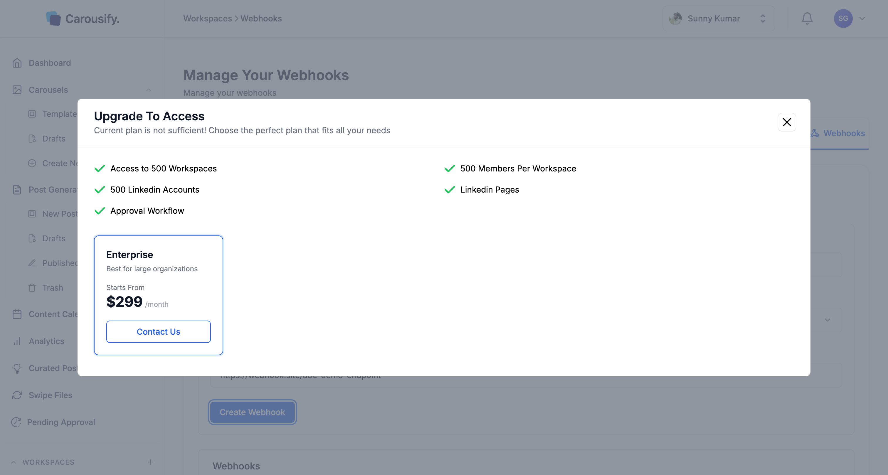

Webhooks are Carousify's developer-facing pipe for the same post events that power the Slack and Zapier integrations — **Post Scheduled**, **Post Published**, and **Post Publish Failed**. You give Carousify an HTTPS endpoint, pick the events you care about, and Carousify sends a signed JSON `POST` to that URL as soon as the event happens.

Reach for webhooks when you're building something custom: a CRM enrichment job, an internal dashboard, a bespoke reporting pipeline, or anything where Slack notifications and Zapier automations don't fit.

<Note>
  Webhooks are available on the **Enterprise** plan. If you need the same events on another plan, the [Slack](/integrations/slack) and [Zapier](/integrations/zapier) integrations deliver them without a custom endpoint.
</Note>

## When to use webhooks vs other integrations

| You want to… | Use |
| --- | --- |
| Get notified in a Slack channel | [Slack integration](/integrations/slack) |
| Pipe events into Google Sheets, Airtable, Teams, or 5,000+ apps | [Zapier integration](/integrations/zapier) |
| Hit your own server, run custom logic, write to your own database | **Webhooks** (this page) |
| Run Carousify actions from Claude, ChatGPT, or another AI assistant | [MCP server](/mcp/overview) |

## Events

You can subscribe one webhook to any combination of these events. They fire for LinkedIn and Instagram posts alike.

| Event | `event` value | Fires when |
| --- | --- | --- |
| **Post Scheduled** | `post.scheduled` | A post is scheduled for a future date and time — from Carousify or by an AI assistant connected over [MCP](/mcp/overview). |
| **Post Published** | `post.published` | A post is published right away — with **Publish** in Carousify or by an AI assistant over MCP. |
| **Post Publish Failed** | `post.publishFailed` | A scheduled post couldn't be published at its scheduled time — for example, the account was disconnected or the platform rejected the post. |

A post scheduled for several accounts sends one event per account.

## Where to find it

In the left sidebar, open **Manage Workspace › Webhooks**.

{/* SCREENSHOT NEEDED: images/webhooks/webhooks-page-empty.png — Manage Workspace › Webhooks with no webhooks yet: "Manage Your Webhooks" header with the Create Webhook button top right, and the "Create Your First Webhook" empty state below */}

The page lists every webhook in this workspace. Click **Create Webhook** (top right, or in the empty state) to add one.

<Note>
  Webhooks are scoped to a single workspace. If you run a workspace per client, set webhooks up inside each workspace separately — they don't carry across.
</Note>

## Step 1 — Stand up an endpoint

You need an HTTPS URL that accepts a `POST` request with a JSON body. It can be:

- A route in your own app (Express, FastAPI, Rails, Laravel — anything that speaks HTTP).
- A serverless function (Cloudflare Workers, AWS Lambda + API Gateway, Vercel Functions).
- A request inspector like [webhook.site](https://webhook.site/) for testing — generate a unique URL, paste it in, fire a test event, and inspect the body.

<Warning>
  Carousify only accepts **HTTPS** URLs on a public domain. Plain `http://` URLs, `localhost`, and bare IP addresses are rejected when you save. If you're developing locally, use a tunnel like ngrok or Cloudflare Tunnel.
</Warning>

## Step 2 — Create the webhook

<Steps>
  <Step title="Click Create Webhook">
    The **Create Webhook** dialog opens.
  </Step>
  <Step title="Fill in the fields">
    - **Webhook Name** — a label you'll recognize later (e.g. `CRM enrichment`). It's only shown inside Carousify.
    - **Events** — open the dropdown and tick any combination of **Post Scheduled**, **Post Published**, and **Post Publish Failed**.
    - **Webhook URL** — paste the HTTPS endpoint from Step 1.

    {/* SCREENSHOT NEEDED: images/webhooks/webhooks-events-open.png — Create Webhook dialog with the Events dropdown open showing Post Scheduled, Post Published and Post Publish Failed checkboxes */}
  </Step>
  <Step title="Click Create Webhook">
    The button stays disabled until you've entered a name and ticked at least one event.

    {/* SCREENSHOT NEEDED: images/webhooks/webhooks-form-ready.png — Create Webhook dialog filled in (name, two events selected, an https URL) with the Create Webhook button enabled */}
  </Step>
  <Step title="Copy the signing secret">
    Carousify shows the webhook's signing secret (it starts with `whsec_`). Copy it and store it with your endpoint's configuration — **it's shown only once**. You'll use it to [verify deliveries](#verify-the-signature).

    {/* SCREENSHOT NEEDED: images/webhooks/webhook-secret.png — Create Webhook dialog after saving, showing the one-time signing secret (whsec_…) with the copy button; blur most of the secret */}
  </Step>
</Steps>

The new webhook appears in the table with its status switch on.

<Note>
  If your plan doesn't include webhooks, **Create Webhook** opens an upgrade prompt instead of the dialog. Reach out to [Support](https://carousify.com/contact-us/) if you'd like to talk through pricing.

  
</Note>

<Note>
  Creating, editing, and deleting webhooks needs a role that can manage the workspace's integrations. If Carousify says you don't have permission, ask the workspace owner or an admin.
</Note>

## Step 3 — Trigger a test event

The fastest way to confirm the wiring is to schedule a real post:

1. Open **New Post** and draft anything — even one line of text.
2. Schedule it for later.
3. A **Post Scheduled** request hits your endpoint within seconds.

To see **Post Published**, publish a post right away with **Publish**. If nothing arrives, jump to [Troubleshooting](#troubleshooting).

## Request shape

Carousify sends a `POST` request with `Content-Type: application/json`. Every event uses the same envelope, so you can write one handler and switch on `event`:

```json
{
  "event": "post.published",
  "data": {
    "id": "65f8b2a14d9c3e0011223344",
    "workspaceId": "65a1f0c8d9b34e0099887766",
    "userId": "6593a4b8e1f234001a2b3c4d",
    "accountType": "profile",
    "accountId": "AbC12dEfGh",
    "content": "We just shipped link tracking for every published post...",
    "title": "",
    "media": [
      "https://cdn.carousify.com/uploads/abc.png"
    ],
    "status": "posted",
    "postUrn": "urn:li:share:7196543210987654321",
    "utmCampaign": null,
    "postingTime": "2026-05-07T10:30:00.000Z",
    "createdAt": "2026-05-07T09:55:12.000Z",
    "updatedAt": "2026-05-07T10:30:04.000Z"
  },
  "timestamp": 1715072404000
}
```

### Headers

| Header | Value |
| --- | --- |
| `webhook-event` | The event name, e.g. `post.published`. |
| `webhook-timestamp` | Unix milliseconds when the request was signed. |
| `webhook-signature` | Hex HMAC-SHA256 signature — see [Verify the signature](#verify-the-signature). |

### Field reference

| Field | Type | Notes |
| --- | --- | --- |
| `event` | string | `post.scheduled`, `post.published`, or `post.publishFailed`. |
| `timestamp` | number | Unix milliseconds — when the event fired. |
| `data.id` | string | Carousify post ID. |
| `data.workspaceId` | string | Workspace the post belongs to. |
| `data.userId` | string | Carousify user who created the post. |
| `data.accountType` | string | `profile` for LinkedIn profiles and Instagram accounts, `pages` for LinkedIn company pages. |
| `data.accountId` | string | The connected account's ID on the platform — the LinkedIn member ID, the LinkedIn organization ID for pages, or the Instagram account ID. Not the vanity name. |
| `data.content` | string | Post text. |
| `data.title` | string | Post title (used for LinkedIn documents), often empty. |
| `data.media` | string[] | URLs of the images, videos, or document attached to the post. |
| `data.status` | string | `scheduled`, `posted`, or `failed`. |
| `data.postUrn` | string \| null | The platform's post ID once the post is live — a LinkedIn URN like `urn:li:share:…`, or the Instagram media ID. `null` before publishing. |
| `data.utmCampaign` | string \| null | UTM campaign value if link tracking was on. |
| `data.postingTime` | ISO 8601 | When the post is scheduled to publish, or when it was published. |
| `data.createdAt` | ISO 8601 | When the post record was created in Carousify. |
| `data.updatedAt` | ISO 8601 | Last modification time. |

The shape matches the [Zapier trigger payload](/integrations/zapier#trigger-payload), so handlers you've written for Zapier data work without changes.

## Verify the signature

Every request is signed with your webhook's secret, so you can reject anything that didn't come from Carousify. The signature is the hex-encoded HMAC-SHA256 of the `webhook-timestamp` header, a dot, and the raw request body, keyed with the full secret (including the `whsec_` prefix):

```text
signature = hex( HMAC_SHA256( secret, webhook-timestamp + "." + rawBody ) )
```

```javascript Node.js (Express)
import crypto from "crypto";
import express from "express";

const app = express();
const SECRET = process.env.CAROUSIFY_WEBHOOK_SECRET; // whsec_...

app.post("/hooks/carousify", express.raw({ type: "application/json" }), (req, res) => {
  const timestamp = req.get("webhook-timestamp");
  const signature = req.get("webhook-signature") ?? "";
  const expected = crypto
    .createHmac("sha256", SECRET)
    .update(`${timestamp}.${req.body.toString("utf8")}`)
    .digest("hex");

  const valid =
    signature.length === expected.length &&
    crypto.timingSafeEqual(Buffer.from(signature), Buffer.from(expected));
  if (!valid) return res.sendStatus(401);

  // Optional: reject old deliveries to limit replays
  if (Math.abs(Date.now() - Number(timestamp)) > 5 * 60 * 1000) return res.sendStatus(401);

  res.sendStatus(200); // acknowledge first
  const { event, data } = JSON.parse(req.body.toString("utf8"));
  // queue your own work here
});
```

<Warning>
  Compute the signature over the **raw** body exactly as received. Parsing the JSON and re-serializing it changes the bytes, and the signature won't match.
</Warning>

## Responding to a delivery

- **Reply with `2xx` quickly.** Carousify waits up to **5 seconds** for a response. Acknowledge first, then queue heavy work (CRM lookups, AI calls, database writes) to run asynchronously.
- **Retries are limited.** If the connection fails or times out, Carousify tries again right away, up to 3 attempts in total. A response with a non-`2xx` status code isn't retried, and there's no delivery log in the app — log failures on your side.
- **Make handlers idempotent.** Use `data.id` plus `event` as a dedupe key — if the same pair shows up twice (for example after a timeout retry), treat the second one as a no-op.

## Manage existing webhooks

The table lists every webhook in this workspace with its name, URL, events, status, and created date.

- **Status** — the switch turns deliveries on or off without deleting the webhook.
- **Edit** (pencil icon) — change the name, events, or URL. The signing secret stays the same.
- **Delete** (trash icon) — removes the webhook after you confirm. Deliveries stop immediately.

To get a new signing secret, delete the webhook and create it again.

## Troubleshooting

- **No requests arriving at my endpoint.** Confirm the webhook's status switch is on, it's subscribed to the event you're testing, and the endpoint is publicly reachable over HTTPS (curl it from outside your network). Then schedule or publish a post to fire a fresh event.
- **Signature never matches.** Sign the raw body, use the `webhook-timestamp` header (not the `timestamp` field in the body), and include the `whsec_` prefix in the key.
- **Endpoint returns 200 but I don't see the data.** You're likely reading the wrong field. Carousify always wraps the post under `data` — log the full body before parsing.
- **"Create Webhook" opens an upgrade prompt.** Webhooks aren't included in your plan. Use the Slack or Zapier integrations in the meantime — both cover the same events.
- **Receiving events for posts I don't expect.** Webhooks are workspace-scoped and fire for every account in the workspace. Filter on `data.accountId` if you only care about one account.

## What's next

<Columns cols={2}>
  <Card title="Zapier integration" icon="bolt" href="/integrations/zapier">
    Same events delivered through Zapier — no code, 5,000+ destinations.
  </Card>
  <Card title="Slack integration" icon="slack" href="/integrations/slack">
    Pipe events into a Slack channel without standing up an endpoint.
  </Card>
  <Card title="MCP server" icon="robot" href="/mcp/overview">
    Let Claude, ChatGPT, or another AI assistant work in Carousify for you.
  </Card>
  <Card title="Schedule a post" icon="calendar" href="/scheduling/schedule-post">
    Trigger your first **Post Scheduled** event and confirm delivery.
  </Card>
</Columns>
