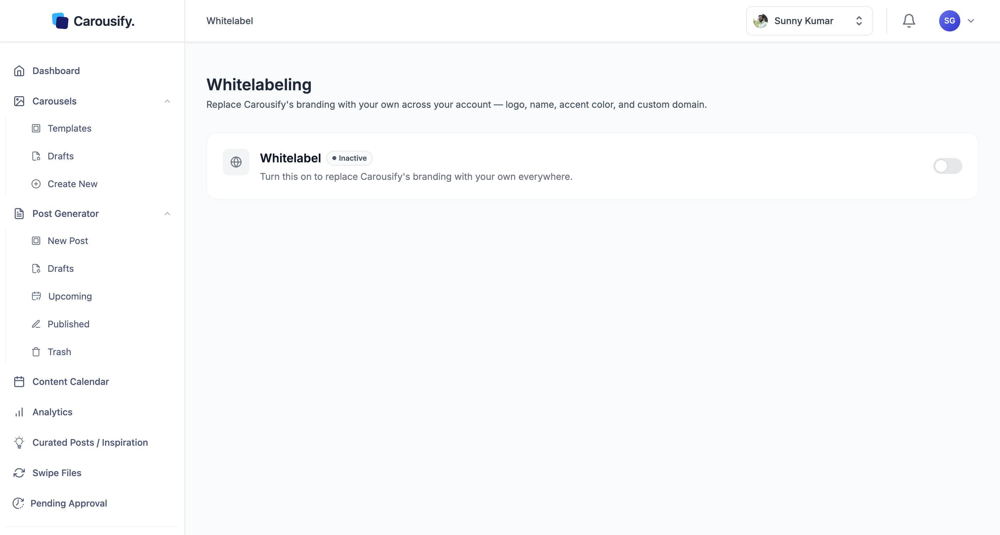
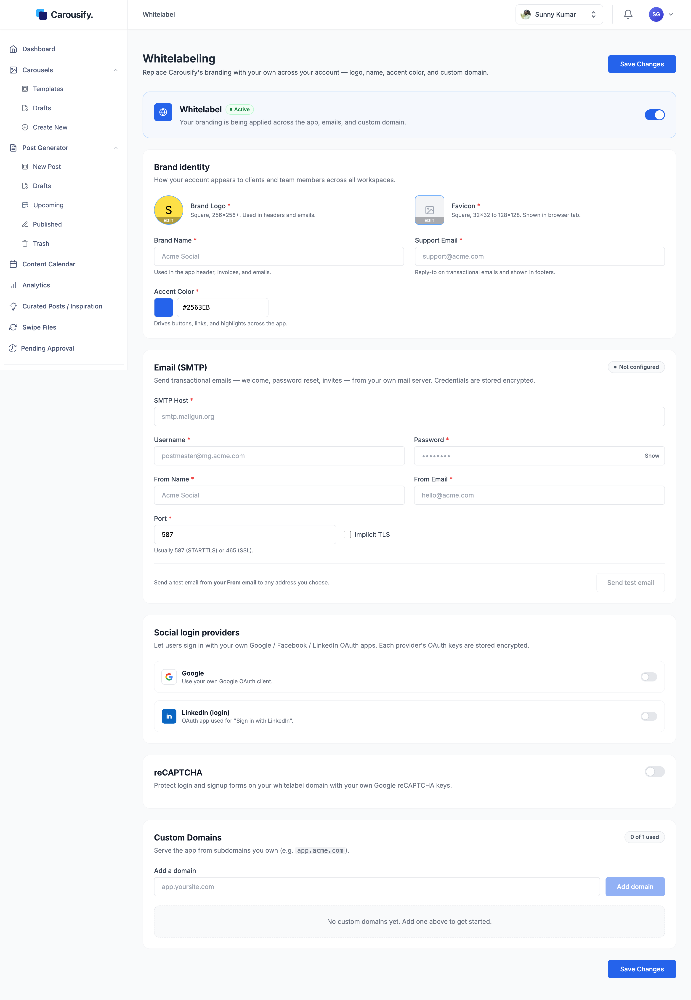

Whitelabeling replaces Carousify's branding with yours everywhere your account is used — the app header, the browser tab, transactional emails, the sign-in screen, and the domain it all loads from. Your clients and team members see *your* product, not Carousify.

Agencies and teams use it to put their own brand in front of clients — when someone you work with opens the platform, everything they see is yours. It looks and feels like a tool you built, not one you signed up for.

<Note>
  Whitelabel is an **Enterprise** feature. On other plans, the Whitelabeling page opens an upgrade prompt — contact [Support](https://carousify.com/contact-us/) to enable it at an additional charge. Whitelabel is **branding only**: it controls how the platform *looks* and doesn't change billing or invoicing.
</Note>

## Account-wide, not per workspace

Most Carousify settings — brand kits, integrations, members — are scoped to a single workspace. **Whitelabel is the exception.** It applies at the account level, across *every* workspace you own.

<Warning>
  Turning whitelabel on rebrands the app for everyone with access to your account, in all workspaces, at once. There's no per-workspace whitelabel — set it up once, and it's the experience all your clients and teammates get.
</Warning>

## Where to find it

In the left sidebar, open **Settings › Whitelabeling**. (People who joined through your whitelabeled domain don't see this page.)

The page opens with a single master switch. While it's **Inactive**, your account uses Carousify's default branding and domain. Flipping it to **Active** reveals the configuration sections.

## Turn whitelabeling on

<Steps>
  <Step title="Flip the Whitelabel switch to Active">
    The status pill changes from **Inactive** to **Active** and the configuration sections appear below.
  </Step>
  <Step title="Fill in Brand identity">
    **Brand Logo**, **Favicon**, **Brand Name**, **Support Email**, and **Accent Color** are all required. See [Branding](/whitelabel/branding).
  </Step>
  <Step title="Set up and test SMTP">
    Whitelabel can't be turned on without your own mail server. Fill in every **Email (SMTP)** field and send a successful test email. See [SMTP](/whitelabel/smtp).
  </Step>
  <Step title="Click Save Changes">
    **Save Changes** sits at both the top and bottom of the page. Nothing applies until you save — toggling the switch alone doesn't persist anything. If a required field is missing, Carousify tells you which one.
  </Step>
  <Step title="Add your custom domain">
    Add the domain and its DNS records so the branded app loads at your own address. See [Custom domain](/whitelabel/custom-domain).
  </Step>
</Steps>

## What you can configure

Whitelabel is grouped into five sections on this one page.

<Columns cols={2}>
  <Card title="Brand identity" icon="palette" href="/whitelabel/branding">
    Logo, favicon, brand name, support email, and accent color — what shows in headers, the browser tab, and emails.
  </Card>
  <Card title="Email (SMTP)" icon="envelope" href="/whitelabel/smtp">
    Send account emails from your own mail server instead of Carousify's.
  </Card>
  <Card title="Custom domains" icon="globe" href="/whitelabel/custom-domain">
    Serve the whole app from a domain you own, like `app.yourbrand.com`.
  </Card>
  <Card title="Sign-in and security" icon="shield" href="#social-sign-in-and-recaptcha">
    Your own Google and LinkedIn OAuth apps for sign-in, plus your own reCAPTCHA keys.
  </Card>
</Columns>

### Brand identity

The **Brand identity** section sets how your account looks to anyone who opens it:

| Field | Where it shows |
| --- | --- |
| **Brand Logo** | App headers and emails. Square, 256×256 px or larger. |
| **Favicon** | The browser tab. Square, 32×32 to 128×128 px. |
| **Brand Name** | App header, invoices, and emails. |
| **Support Email** | Reply-to address on transactional emails and shown in footers. |
| **Accent Color** | Buttons, links, and highlights across the app. |

Full walkthrough on [Branding](/whitelabel/branding).

### Email and domain

Two sections turn Carousify into something that *is* your product rather than something that emails and links back to ours:

- **Email (SMTP)** — point Carousify at your own mail server so transactional emails come from your domain, not Carousify's. Credentials are stored encrypted. Required to turn whitelabel on. See [SMTP](/whitelabel/smtp).
- **Custom Domains** — add a domain you own (e.g. `app.acme.com`) and the entire app loads from it. See [Custom domain](/whitelabel/custom-domain) for the DNS steps.

### Social sign-in and reCAPTCHA

Two more sections live on the same page and don't have separate guides — configure them here:

- **Social login providers** — on your whitelabeled domain, the **Google** and **LinkedIn** sign-in buttons appear only when you add your own OAuth app for that provider, so the consent screen shows *your* brand. Turn a provider on, enter its **Client ID** and **Client Secret**, and follow the **Setup guide** inside the section — it lists the exact origin and redirect URLs to register in Google Cloud Console or the LinkedIn Developer Portal. Those URLs use your custom domain, so add and verify the domain first. Keys are stored encrypted.
- **reCAPTCHA** — protect the login and signup forms on your whitelabel domain with your own Google reCAPTCHA **Site Key** and **Secret Key**.

<Tip>
  Social login and reCAPTCHA are optional. Without a provider configured, people sign in to your branded domain with email and password only. Two-factor authentication applies to every sign-in method — see [Account security](/billing/account-security#two-factor-authentication).
</Tip>

To remove a sign-in provider, turn its switch off and click **Confirm**. Its Client ID and secret are deleted when you click **Save Changes**, so you'll need to enter them again to turn it back on.

## Saving and applying changes

**Save Changes** persists everything on the page in one go. Branding, colors, and email take effect immediately after saving. A custom domain only goes live once its DNS records resolve and the certificate is issued — that part is covered in [Custom domain](/whitelabel/custom-domain).

## Turn whitelabeling off

Flip the master switch back to **Inactive**. Carousify asks you to confirm in a **Disable Whitelabeling?** dialog — click **Disable & Delete** to go ahead.

<Warning>
  Turning whitelabel off yourself **permanently deletes** all whitelabel settings: brand identity, SMTP configuration, sign-in providers, reCAPTCHA keys, and your custom domain. The domain is removed from Carousify right away and stops serving the app. To use whitelabel again, you set everything up from scratch.
</Warning>

## If your plan changes

Whitelabel follows your plan and account status:

- **Your branded site stops at once** if your plan no longer includes whitelabeling, or if your account is deactivated, suspended, or deleted. Your custom domain no longer shows your branding.
- **Your custom domain is released** — removed from Carousify's hosting, so it stops pointing at the app — as soon as your plan ends and your account moves to the Free plan. For other plan changes that drop whitelabeling, Carousify waits **7 days** first, so a short lapse doesn't cost you your setup. Upgrading again within those 7 days keeps the domain.
- **Your brand settings are kept** — logo, name, colors, SMTP, and sign-in providers stay saved. When you upgrade again, turn whitelabel back on and add your domain again (with its DNS records).
- **Deleting your account** releases all of your custom domains.

You'll see a notice in your activity feed when whitelabel is turned off for a plan change.

## What's next

<Columns cols={2}>
  <Card title="Custom domain" icon="globe" href="/whitelabel/custom-domain">
    Point a domain you own at Carousify and serve the app from it.
  </Card>
  <Card title="Branding" icon="palette" href="/whitelabel/branding">
    Logo, favicon, name, support email, and accent color, step by step.
  </Card>
  <Card title="SMTP" icon="envelope" href="/whitelabel/smtp">
    Send transactional emails from your own mail server.
  </Card>
  <Card title="Manage clients" icon="briefcase" href="/workspaces/clients">
    Combine whitelabel with client workspaces for a fully branded agency setup.
  </Card>
</Columns>
