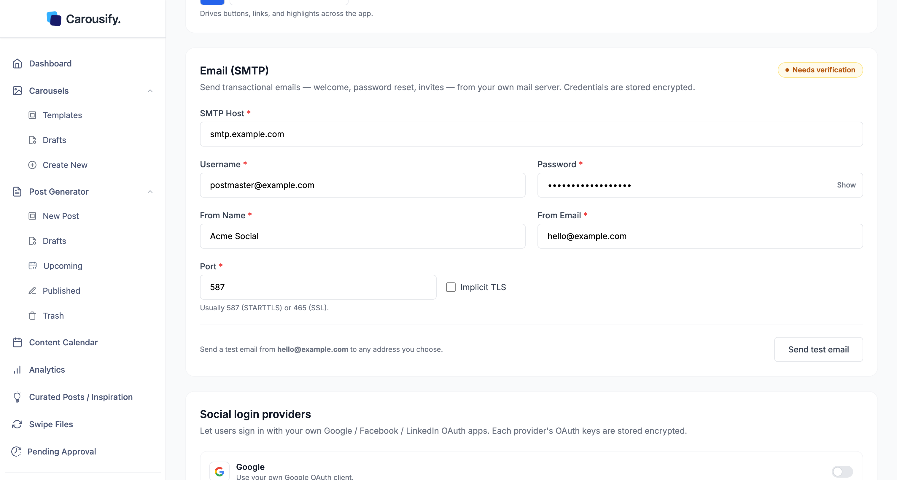
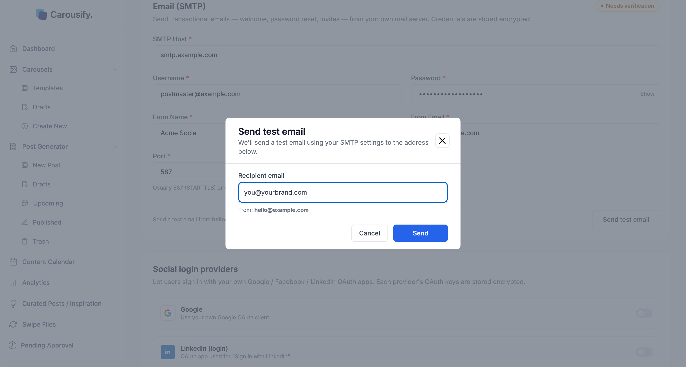

SMTP sends your account's transactional emails — welcome emails, password resets, workspace invites, and failed-post alerts — from your own mail server, so they reach clients and members from your domain, not Carousify's. They also carry your brand name and logo. Credentials are stored encrypted.

SMTP is **required** to turn whitelabel on: every field must be filled and a test email must succeed before the whitelabel settings save.

<Note>
  SMTP is part of whitelabel, an **Enterprise** feature, and applies once whitelabel is **Active** (see [Whitelabel overview](/whitelabel/overview)). On other plans, contact [Support](https://carousify.com/contact-us/) to enable it at an additional charge.
</Note>

## Set it up

Open **Settings › Whitelabeling** and find the **Email (SMTP)** section.

Fill in your mail provider's details:

| Field | Value |
| --- | --- |
| **SMTP Host** | Your provider's server, e.g. `smtp.mailgun.org`. |
| **Username** / **Password** | Your SMTP login. Use **Show** to check the password. Once saved, leave the password blank to keep it, or type a new one to replace it. |
| **From Name** / **From Email** | The sender recipients see. |
| **Port** | `587` (STARTTLS) or `465` (SSL — turn on **Implicit TLS**). |

## Test before it saves

The section's status pill shows **Not configured** until you fill in the fields, then **Needs verification**, and **Verified** after a successful test. Carousify makes you send a working test email before the settings save — and again whenever you change the host, port, login, or sender — so a wrong host or credential is caught now, not by a client.

<Steps>
  <Step title="Click Send test email">
    The **Send test email** dialog opens with a **Recipient email** field and the **From** address.
  </Step>
  <Step title="Send and check the inbox">
    Adjust the recipient if you like, click **Send**, and confirm the email arrives.
  </Step>
  <Step title="Click Save Changes">
    A successful test verifies the setup. If nothing arrives, fix the host, port, TLS, or credentials and test again.
  </Step>
</Steps>

## What's next

<Columns cols={2}>
  <Card title="Branding" icon="palette" href="/whitelabel/branding">
    Logo, favicon, name, and accent color.
  </Card>
  <Card title="Custom domain" icon="globe" href="/whitelabel/custom-domain">
    Serve the app from a domain you own.
  </Card>
  <Card title="Whitelabel overview" icon="envelope" href="/whitelabel/overview">
    How SMTP fits the whitelabel setup.
  </Card>
  <Card title="Manage clients" icon="briefcase" href="/workspaces/clients">
    Run client workspaces in your branded setup.
  </Card>
</Columns>
