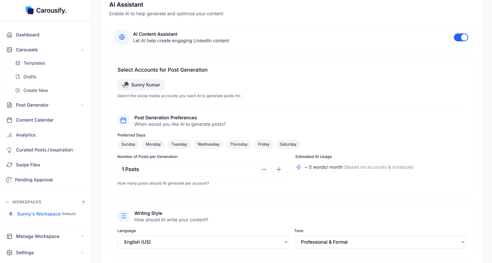
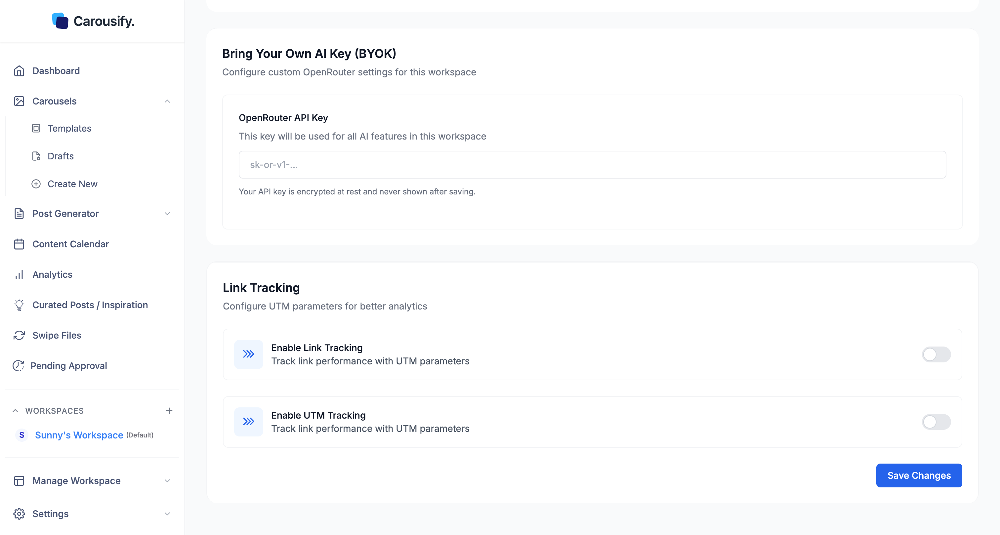

The **AI Assistant** section under **Manage Workspace › General** sets the writing defaults every AI generation in this workspace inherits — Post Generator, AI carousels, and the in-editor assistant.

## Writing defaults

<Steps>
  <Step title="Pick a Language">
    English (US/UK) plus 90+ other languages.
  </Step>
  <Step title="Pick a Tone">
    **Professional & Formal**, **Conversational & Friendly**, **Technical & Detailed**, or **Inspirational & Motivating**.
  </Step>
  <Step title="Save Changes">
    Hit **Save Changes** at the bottom of the section.
  </Step>
</Steps>

<Note>
  A few **post templates** let you override language or tone for a single run. Everywhere else, these workspace defaults are what AI uses.
</Note>

The same panel also has an **AI Content Assistant** toggle that powers the **Curated Posts / Inspiration** feed in the sidebar — see [Curated Posts](/post-generator/curated-posts) for that flow.

## Bring Your Own AI Key (BYOK)

Below the AI Assistant section, **BYOK** lets you swap Carousify's default AI for your own [OpenRouter](https://openrouter.ai/) key — per workspace.

<Steps>
  <Step title="Get an OpenRouter key">
    Sign up at [openrouter.ai](https://openrouter.ai/), top up your account, and create a key (`sk-or-v1-...`).
  </Step>
  <Step title="Paste it into the OpenRouter API Key field">
    Once a key is entered, the model settings appear below it.
  </Step>
  <Step title="Pick and test your models">
    Choose a model for each job and click **Test Model** next to it. Carousify won't save a model that hasn't passed a test with your key.

    | Setting | Used for |
    | --- | --- |
    | **General Model** | Headlines, comments, and posts |
    | **Advanced Model** | Carousel generation only |
    | **Image Generation Model** | AI image generation only |
    | **Reasoning Effort** | How much the model reasons before answering (high, medium, low, minimal, or none) |
    | **Enable Web Search** | Lets the AI search the web for real-time information. Adds OpenRouter cost per request. |
  </Step>
  <Step title="Click Save Changes">
    Every AI request in this workspace now runs through your key — billed to your OpenRouter account, not Carousify's. Paste a new key to rotate it.
  </Step>
</Steps>

To go back to Carousify's AI, click **Remove** next to the saved key and confirm **Delete Key**. Future AI requests then use your plan's monthly AI words again.

You need the **Modify Workspace** permission to change BYOK settings.

### Why use BYOK

- **No AI word limits** — usage is capped by your OpenRouter credit, not your Carousify plan
- **Pick the model** — choose from the Claude, GPT, Gemini, GLM, and image models listed in each dropdown
- **Compliance / billing** — useful when a client wants AI requests routed through their own provider

### Security

Your API key is **encrypted at rest** and never shown back in the UI after saving. Carousify only uses it to send this workspace's AI requests to OpenRouter. Pasting a new key replaces the stored one.

<Tip>
  BYOK is per workspace. Mix Carousify-billed AI in one workspace with your own key in another — handy if some clients pay for their own AI usage and others don't.
</Tip>
