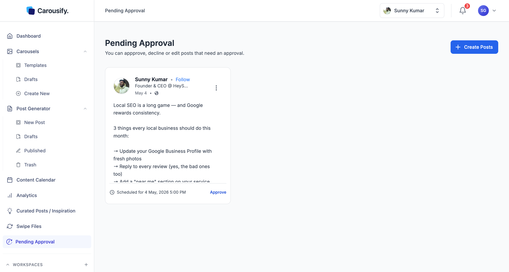

Approval routes posts through a review step before they publish. You decide which roles need it — turn **Requires Approval** on for a role and posts from anyone on that role land in **Pending Approval** for someone with the **Approve Posts** permission to sign off on. It works on any role except Owner, including Admin if the Owner wants final say.

<Note>
  Approval is available on **Business** and **Enterprise** plans. On other plans the **Pending Approval** page isn't in the sidebar. See [Plans and pricing](/billing/plans).
</Note>

## How it's wired

There's no separate "approval" setting — it's a per-role toggle on **Manage Workspace › Roles**. Flip **Requires Approval** on for any role and every post someone on that role tries to schedule or publish gets routed to Pending Approval first. Only the workspace **Owner** can change these toggles.

By default the toggle is **off** for every role. Turn it on for whichever roles you want gated — common setups are **Member** (writers ship to a queue, Admin signs off) or **Admin** when an Owner wants final say on everything that goes out. You can mix freely.

See [Roles and permissions](/workspaces/roles#the-approval-gate) for the full toggle behavior.

<Tip>
  Approval also applies to AI assistants. Posts created through an MCP key or AI assistant connection follow the role of the member who set it up, so a writer's assistant can't skip review. Reviewers can approve or reject from their own assistant too. See [MCP overview](/mcp/overview).
</Tip>

## What writers see

When a member with Requires Approval clicks **Publish** or **Schedule**, the post doesn't go to LinkedIn or Instagram — it goes to Pending Approval and its card shows **Approval Requested**. The post keeps its original scheduled time. If nobody approves it before that time, it doesn't publish; the reviewer has to pick a new time when approving.

## Reviewing pending posts

Open **Pending Approval** in the left sidebar. Every post awaiting review is listed as a card with a preview — author, body, and the time it's scheduled for.

## Approve, edit, or decline

Each pending post has three actions. The primary **Approve** button sits on the card; **Edit** and **Decline** are tucked under the kebab menu in the top-right corner of the card.

| Action | What happens |
| --- | --- |
| **Approve** | Opens the post in the editor. Review it, click **Continue**, then click **Approve** to publish it now or **Schedule** to keep or change its time. |
| **Edit** | Opens the post in the editor so you can make changes. Needs the **Edit Drafts** permission. |
| **Decline** | Asks you to confirm, then moves the post back to Drafts. Nothing publishes. |

The **Approve** button and **Decline** only appear for reviewers — members whose role has **Approve Posts** and doesn't have Requires Approval.

<Tip>
  Use **Edit** for small copy fixes you'd otherwise nag the writer about — typos, hashtag swaps, link cleanups. Use **Decline** when the angle or content needs a real rewrite.
</Tip>

## What's next

<Columns cols={2}>
  <Card title="Roles and permissions" icon="shield" href="/workspaces/roles">
    Toggle Requires Approval on the roles you want gated, or build a custom approver tier.
  </Card>
  <Card title="Invite team members" icon="user-plus" href="/workspaces/invite-team">
    Add writers under a role with Requires Approval on so their work routes through review.
  </Card>
  <Card title="Content Calendar" icon="calendar" href="/scheduling/calendar">
    Spot-check the queue after approving.
  </Card>
  <Card title="Manage clients" icon="briefcase" href="/workspaces/clients">
    Combine approval with client workspaces for ghostwriter / agency setups.
  </Card>
</Columns>
