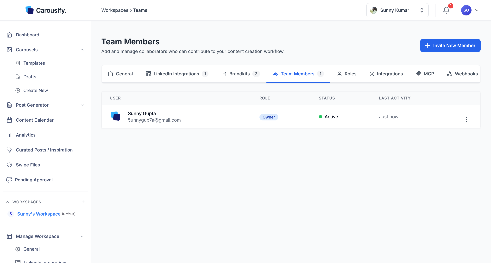
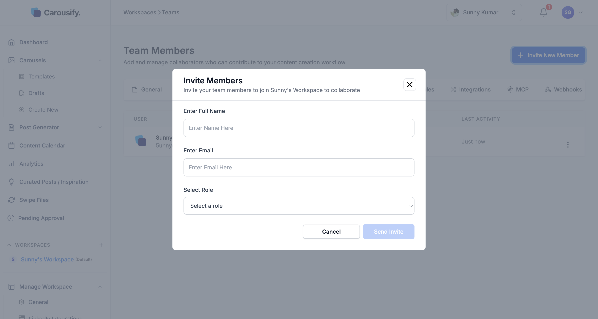
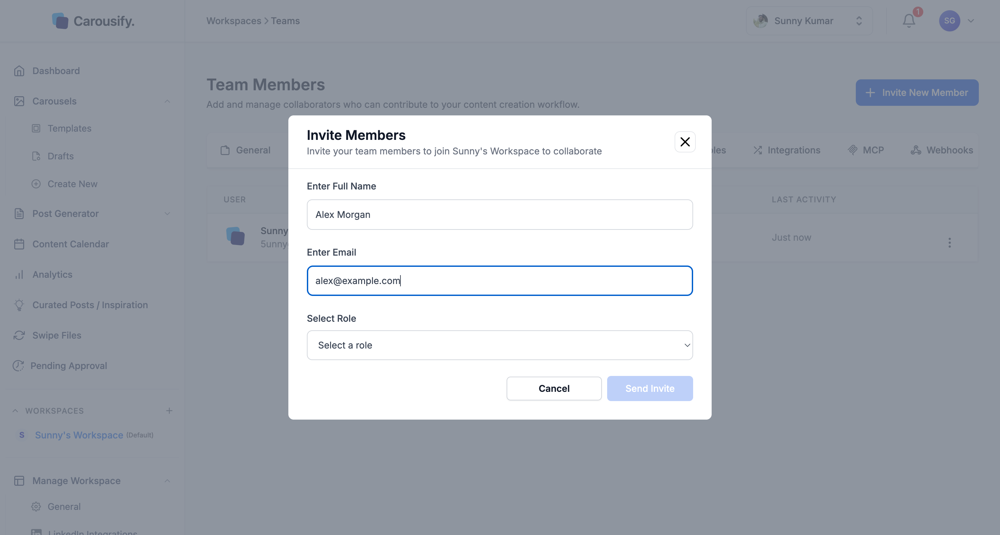

Workspaces are designed to be shared. Invite teammates, freelancers, or clients into a workspace and they can co-author posts, design carousels, and run the calendar with you — under the role you choose.

<Note>
  The number of members you can invite per workspace is plan-dependent. Hobby includes 3 members per workspace, Startup 5, Business 10, and Enterprise up to 500. See [Plans and pricing](/billing/plans).
</Note>

## Open Team Members

In the left sidebar, click **Manage Workspace › Team Members**.

{/* SCREENSHOT NEEDED: images/workspaces/team-members-list.png — Manage Workspace › Team Members with the current settings tab bar (General, Social Integrations, Brandkits, Team Members, Roles, Integrations, MCP, Webhooks, Extension), the Invite New Member button and the members table (User, Role, Status, Last Activity, Actions) with the Owner row and ideally one pending invitation. Replaces the existing image, whose tab bar still says "LinkedIn Integrations". */}

The table lists every member and pending invitation in this workspace with **User**, **Role**, **Status**, **Last Activity**, and **Actions** columns. The workspace creator shows up as **Owner** and can't be removed — but ownership can be [transferred](#transfer-ownership).

<Tip>
  Members are scoped to a single workspace. If you run several workspaces — say, one per client — you'll invite people into each workspace separately, even if it's the same email address.
</Tip>

## Send an invite

Click **Invite New Member** in the top right. The **Invite Members** dialog opens.

Fill in three fields:

| Field | What to enter |
| --- | --- |
| Enter Full Name | The teammate's name as you want it shown across the workspace. |
| Enter Email | The address Carousify sends the invite to. They'll sign up (or sign in) with this email. |
| Select Role | **Admin**, **Member**, **Client**, or any custom role in this workspace — see [Roles and permissions](/workspaces/roles) for what each can do. |

Click **Send Invite**. Carousify emails the invitee a link to join — they'll create an account (or sign in) with the same email and land directly inside this workspace.

## What happens after you send

- The invitee gets an email with a join link
- The invitation appears in the table immediately with a **Pending** status
- Once they accept and sign in, they show up as a member with an **Active** status
- They land inside *this* workspace by default — they can switch to others they've been invited to from the sidebar's **WORKSPACES** list

Invitations that aren't accepted within 30 days change to **Expired**. Use **Resend Invitation** to send a fresh email.

## Manage invitations

Open the actions menu on a pending invitation to:

- **Edit Invitation** — change the name, email, or role before they accept
- **Resend Invitation** — re-send the email if they never received it or it expired
- **Delete** — cancel the invitation so the link no longer works

## Manage existing members

From the actions menu on each member row you can:

- **Change Role** — promote a Member to Admin, or move someone to Client without re-inviting
- **Remove Member** — revoke access to this workspace. Their drafts and scheduled posts stay; they just can't open them anymore
- **Leave Workspace** — shown on your own row if you're not the Owner

Which actions you see depends on your role's **Add User**, **Add Admin**, and **Remove User** permissions — see [Roles and permissions](/workspaces/roles).

<Warning>
  Removing a member is workspace-scoped, not account-wide. If the same person is in another workspace you own, they keep access there.
</Warning>

## Transfer ownership

The Owner can hand a workspace to another member. Ownership can only go to someone who is already an **Admin** in the workspace.

<Steps>
  <Step title="Open the Admin's actions menu">
    On **Team Members**, open the actions menu on the Admin's row and click **Transfer Ownership**.
  </Step>
  <Step title="Confirm with your password">
    Enter your Carousify password and click **Transfer**. If you signed up with Google or LinkedIn and never set a password, no password is needed — consider [setting one](/billing/account-security#password).
  </Step>
</Steps>

The new owner takes over the workspace — including its plan limits, which now count against *their* plan — and you become an **Admin**.

<Note>
  The transfer is refused if:

  - The password is wrong
  - The workspace is your default workspace
  - The new owner's plan is lower than yours
  - The new owner has no free workspace slot left on their plan
</Note>

## What's next

<Columns cols={2}>
  <Card title="Roles and permissions" icon="shield" href="/workspaces/roles">
    The full matrix of what Owner, Admin, Member, and Client can each do.
  </Card>
  <Card title="Manage clients" icon="briefcase" href="/workspaces/clients">
    Run a workspace for a client without sharing logins or LinkedIn credentials.
  </Card>
  <Card title="Approval workflow" icon="circle-check" href="/workspaces/approval">
    Require an Admin or Owner to sign off before scheduled posts go live.
  </Card>
  <Card title="Workspace overview" icon="layer-group" href="/workspaces/overview">
    How workspaces, brand kits, and integrations fit together.
  </Card>
</Columns>
