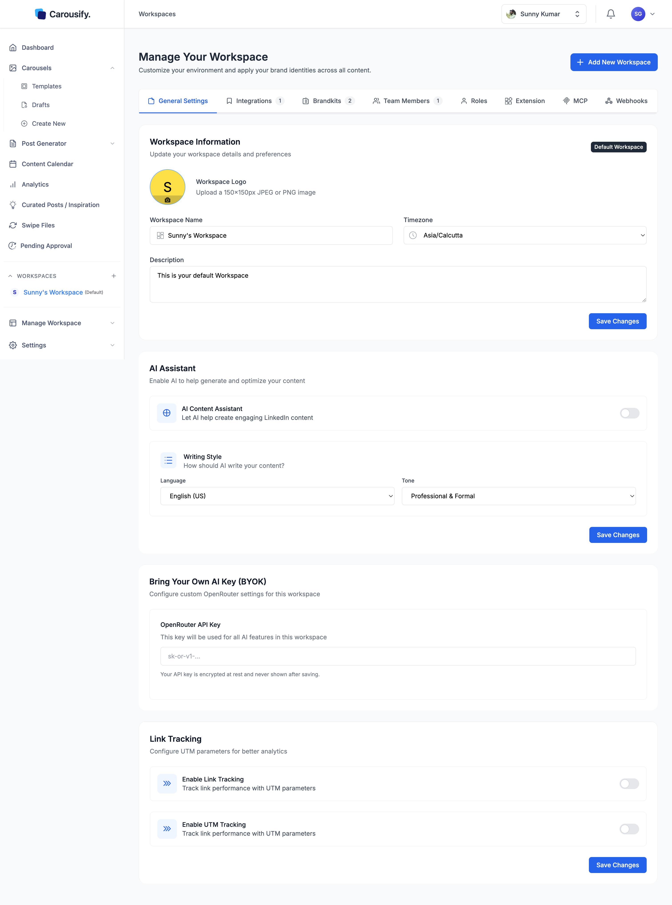
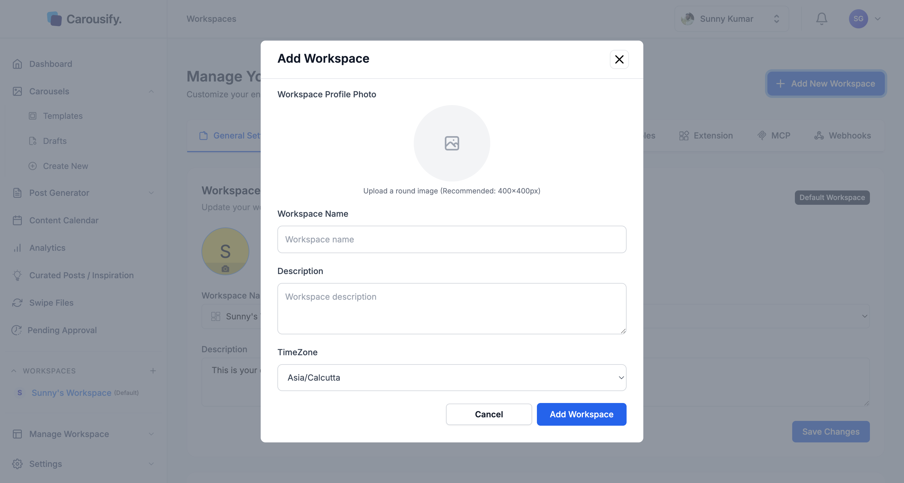

A **workspace** is a self-contained environment for one brand, client, or team. Each workspace has its own LinkedIn and Instagram accounts, brand kits, members, drafts, scheduled posts, and analytics — nothing leaks between workspaces.

If you only manage your own LinkedIn, the default workspace Carousify creates at signup is all you need. Agencies, ghostwriters, and in-house teams running multiple brands use multiple workspaces — one per client or brand.

## Where workspaces live

Open **Manage Workspace › General** from the left sidebar to see and edit the active workspace.

{/* SCREENSHOT NEEDED: images/workspaces/general.png — Manage Workspace › General with the current settings tab bar (General, Social Integrations, Brandkits, Team Members, Roles, Integrations, MCP, Webhooks, Extension): Workspace Information (name, logo, timezone, description), AI Assistant, BYOK, Link Tracking and the Danger Zone. Replaces the existing image, whose tab bar still says "LinkedIn Integrations". */}

The **WORKSPACES** list in the sidebar shows every workspace you have access to. Click any workspace name to switch — the whole app (drafts, calendar, analytics, integrations) reloads against that workspace.

## What's stored per workspace

Each workspace owns:

- **Workspace info** — name, logo, timezone (used for scheduling), description
- **Brand kits** — fonts, colors, logo, and author identity for carousels. Logos are stored in the workspace's own uploads
- **Social accounts** — LinkedIn profiles, LinkedIn pages, and Instagram accounts connected for this workspace only (see [Connect your LinkedIn account](/getting-started/connect-linkedin))
- **Integrations, webhooks, and AI assistant connections** — Notion, Slack, Zapier, [webhooks](/webhooks/overview), [MCP](/mcp/overview), and browser extension keys
- **Team members and roles** — who can do what inside the workspace
- **AI defaults** — language, tone, optional Bring-Your-Own-Key (OpenRouter)
- **Link tracking & UTM** — toggle on per workspace if you want shortened, attributable links
- **Drafts, scheduled posts, published posts, analytics** — fully scoped to the workspace

<Note>
  Switching workspace is a hard context switch. A draft you start in one workspace stays there — it doesn't follow you into another workspace.
</Note>

## Add a new workspace

Click **Add New Workspace** at the top of the **Manage Your Workspace** page (or the **+** in the sidebar workspace list).

Fill in the name, timezone, and an optional logo and description, then save — the new workspace appears in the sidebar immediately.

<Tip>
  Workspace count is plan-dependent. Hobby includes 1, Startup 3, Business 10, Enterprise up to 500 — see [Plans and pricing](/billing/plans).
</Tip>

## Delete a workspace

At the bottom of **Manage Workspace › General**, the **Danger Zone** has **Delete this workspace**. Type `DELETE` to confirm. You need the **Delete Workspace** permission, and you can't delete your default workspace.

Deleting is immediate for everyone: team members lose access, scheduled posts are cancelled, and connected accounts are disconnected. The workspace's data — posts, brand kits, templates, analytics — is permanently removed about 7 days later.

<Warning>
  There's no undo in the app. Export anything you want to keep before deleting.
</Warning>

## What's next

<Columns cols={2}>
  <Card title="Invite your team" icon="user-plus" href="/workspaces/invite-team">
    Add members to a workspace and assign them roles.
  </Card>
  <Card title="Roles and permissions" icon="shield" href="/workspaces/roles">
    Control what each member can see and do.
  </Card>
  <Card title="Connect client LinkedIn accounts" icon="briefcase" href="/workspaces/clients">
    Manage multiple clients without holding their credentials.
  </Card>
  <Card title="Approval workflow" icon="circle-check" href="/workspaces/approval">
    Require manager review before posts go live.
  </Card>
</Columns>
