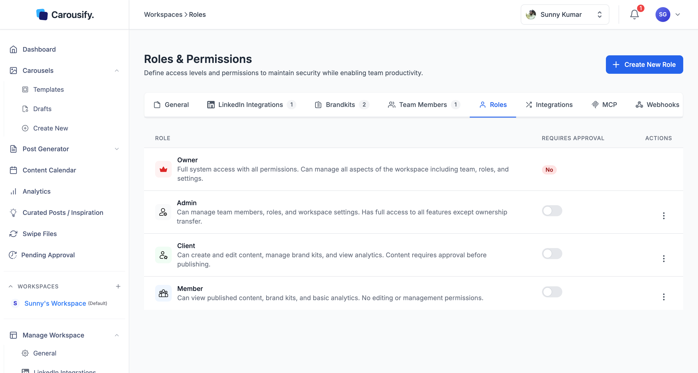
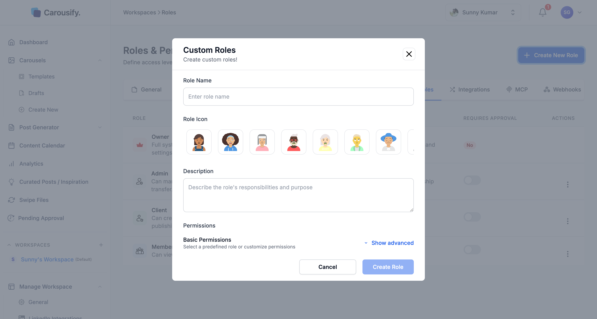
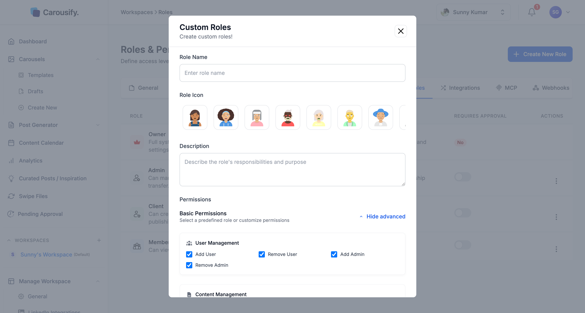

Every member of a workspace acts under a **role** — a named bundle of permissions. Carousify ships with four built-in roles and lets you create your own with granular permission toggles for teams that need something tighter or looser.

Open **Manage Workspace › Roles** to see them.

{/* SCREENSHOT NEEDED: images/workspaces/roles-list.png — Manage Workspace › Roles with the current settings tab bar (General, Social Integrations, Brandkits, Team Members, Roles, Integrations, MCP, Webhooks, Extension), the Create New Role button and the roles table (Owner, Admin, Member, Client, plus one custom role) with Requires Approval toggles and Actions menus. Replaces the existing image, whose tab bar still says "LinkedIn Integrations". */}

<Note>
  Custom roles and the **Requires Approval** toggle need a plan with advanced user management — **Business** or **Enterprise**. On other plans, clicking **Create New Role** or a toggle opens an upgrade prompt. See [Plans and pricing](/billing/plans).
</Note>

## Built-in roles

| Role | What they can do |
| --- | --- |
| **Owner** | Full system access. Manages team, roles, billing, and workspace settings. Created automatically with the workspace and can't be removed. Ownership can be handed to an Admin — see [Transfer ownership](/workspaces/invite-team#transfer-ownership). |
| **Admin** | Everything except ownership — manages team, roles, integrations, brand kits, and content. |
| **Member** | Creates and edits content, manages brand kits, views analytics. The default for writers, designers, and editors. |
| **Client** | View-only — sees published content, brand kits, and basic analytics. Can't create or edit anything. The right role for the brand owner you're producing for. |

The permissions of built-in roles are fixed. To change one, duplicate it and edit the copy (see [Edit, duplicate, or delete a role](#edit-duplicate-or-delete-a-role)).

## The approval gate

Each role except Owner has a **Requires Approval** toggle on the roles table. Turn it on and any post a member of that role schedules or publishes lands in **Pending Approval** instead of going live — someone whose role has **Approve Posts** (and no Requires Approval) has to sign off first.

This is how Carousify's [approval workflow](/workspaces/approval) is wired. Requires Approval is **off** for every role by default — turn it on for the roles you want to gate (typically **Member**, so writers ship to a queue an Admin signs off on). **Client** is view-only, so the toggle has no effect there.

<Warning>
  Only the workspace **Owner** can change Requires Approval. Anyone else gets an error when they click a toggle.
</Warning>

The toggle saves as soon as you click it. The change applies to *future* posts — anything already scheduled keeps its existing approval state.

## Create a custom role

If the four built-ins don't fit, click **Create New Role** in the top right. You need a role that can edit roles (Owner or Admin by default).

<Steps>
  <Step title="Name the role">
    Pick a name your team will recognize — *Editor*, *Junior Writer*, *Approver*. The names **Owner**, **Admin**, **Member**, and **Client** are reserved.
  </Step>
  <Step title="Pick an icon">
    Choose from admin, editor, approver, viewer, analyst, manager, contributor, or guest. An icon is required — it shows next to the role on the roles table.
  </Step>
  <Step title="Add a description">
    One-liner so future Admins know what the role is for. Required.
  </Step>
  <Step title="Set permissions">
    The dialog opens with every permission ticked. Click **Show advanced** to see each permission and untick the ones this role shouldn't have.
  </Step>
</Steps>

### The permission checklist

**Show advanced** opens five permission groups:

| Group | Permissions |
| --- | --- |
| **User Management** | Add User, Remove User, Add Admin, Remove Admin |
| **Content Management** | Schedule Post, Publish Post, View Scheduled Posts, View Published Posts, Approve Posts, Edit Drafts, Add Clients |
| **Integrations** | Add Linkedin, Remove Linkedin — these cover connecting and disconnecting every social account, Instagram included |
| **Templates** | Create Template, Edit Template, Delete Template |
| **Brand And Workspace** | Modify Workspace, Delete Workspace, Add Brandkit, Edit Brand Kit |

Use the **Quick select** buttons at the bottom to **Select All**, **Select None**, or **Default** (which also ticks every permission).

A role needs at least one permission. You can only grant permissions your own role has — if you tick one you don't hold, Carousify refuses to save the role.

<Tip>
  The fastest way to build a custom role is to **Duplicate Role** on the closest built-in role, rename the copy, and untick the few permissions that differ.
</Tip>

Click **Create Role** when you're done. The role appears in the table immediately and shows up in the **Select Role** dropdown when you [invite a new member](/workspaces/invite-team).

### API keys and AI assistant connections

Permissions for API keys and for connecting AI assistants over MCP (**Create MCP key**) aren't in the checklist. Built-in roles carry them as set by Carousify. A custom role you build from scratch doesn't include them, so its members can't create API keys or connect an AI assistant to the workspace. A role you duplicate from a built-in keeps that role's setting.

An MCP key or AI assistant connection acts with the role of the member who created it — for example, posts sent through a key created by someone whose role has Requires Approval on land in Pending Approval. See [MCP overview](/mcp/overview).

## Edit, duplicate, or delete a role

Each role row has an **Actions** menu:

| Action | Built-in roles | Custom roles |
| --- | --- | --- |
| **Edit** | Not available — duplicate the role instead | Change the name, icon, description, and permissions |
| **Duplicate Role** | Opens a new role prefilled with its permissions | Same |
| **Delete Role** | Not available | Deletes the role |

<Warning>
  You can't delete a custom role while it's in use. If a member has the role, or a pending invitation was sent with it, Carousify blocks the delete — change those members' roles (or edit or delete the invitation) first.
</Warning>

## What's next

<Columns cols={2}>
  <Card title="Invite team members" icon="user-plus" href="/workspaces/invite-team">
    Send invites and assign one of these roles.
  </Card>
  <Card title="Approval workflow" icon="circle-check" href="/workspaces/approval">
    How Requires Approval routes posts through Pending Approval.
  </Card>
  <Card title="Manage clients" icon="briefcase" href="/workspaces/clients">
    Run a workspace for a client without sharing logins.
  </Card>
  <Card title="Workspace overview" icon="layer-group" href="/workspaces/overview">
    Where roles fit alongside brand kits, integrations, and members.
  </Card>
</Columns>
